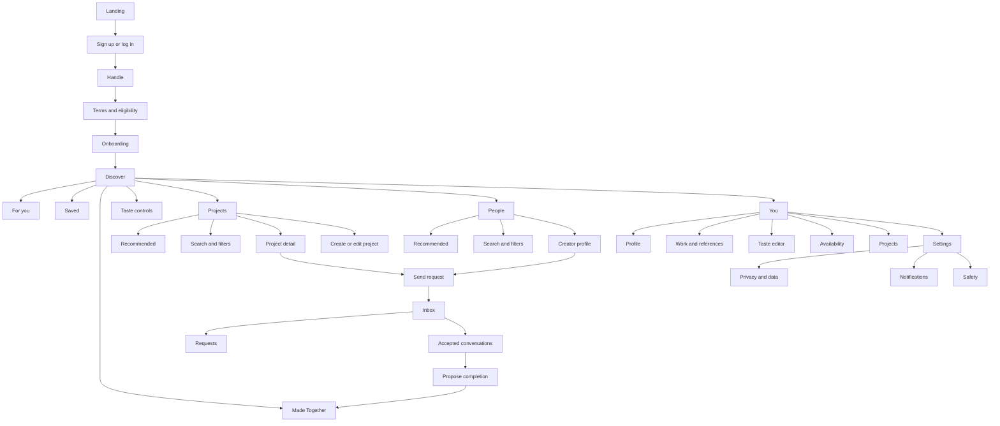

# Kizuki Notion source extracts

Related: [[playbook]], [[00-what-exists]].

Fetched through the Notion connector on 2026-10-24. These are source snapshots, not newly approved decisions. Original page content is retained in Notion-flavored Markdown. Signed media URLs and cover metadata are omitted. Linked child pages are not recursively included.

## Kizuki

Source: https://app.notion.com/p/16858cc06d1b805d9639d7810bd0a781?pvs=204

Page last edited: 2026-10-24T14:15:25.363Z. Notion verification: unverified. The response did not expose truncation or unknown-block counters unless stated below.

Here is the result of "fetch" for the Page with URL https://app.notion.com/p/16858cc06d1b805d9639d7810bd0a781 as of 2026-10-24T14:55:57.073Z:
<page url="https://app.notion.com/p/16858cc06d1b805d9639d7810bd0a781">
<ancestor-path></ancestor-path>
<properties>
{"title":"Kizuki"}
</properties>
<iconMetadata>null</iconMetadata>
<content>
<b>Find your people. Make something real.</b>

Kizuki is a cross-disciplinary creative collaboration app for finding people and projects that fit the work, based on taste, skills, intent, availability, location, and trust.

## Start Here

<page url="https://app.notion.com/p/36458cc06d1b81e68ce9c391f6ec9daf" color="orange">
Canonical Product Brief
</page>

<page url="https://app.notion.com/p/36458cc06d1b819493e5cb164946b0ac" color="yellow">
App Optimization Plan
</page>

## Strategy

<page url="https://app.notion.com/p/16858cc06d1b808284c4e0a0cae9b544" color="orange">
Value Proposition & Key Features
</page>

<page url="https://app.notion.com/p/17458cc06d1b809197d3e147f7c31d76" color="brown">
Hypothesis
</page>

<page url="https://app.notion.com/p/16858cc06d1b80e9a595efa709f7fc05" color="purple">
Business Plan
</page>

<page url="https://app.notion.com/p/16e58cc06d1b8006b919d8f9202409d9" color="blue">
Costs
</page>

<page url="https://app.notion.com/p/18e58cc06d1b809b8dfdccedb8a391e7" color="green">
Roadmap
</page>

## Product

<page url="https://app.notion.com/p/16b58cc06d1b8068bd08f9763fa89dfa" color="yellow">
Core Product
</page>

<page url="https://app.notion.com/p/16b58cc06d1b80b6ba80ca73a978865a" color="yellow">
Development
</page>

## Research

<page url="https://app.notion.com/p/32958cc06d1b8027b6f3d70d7cd80cf9" color="pink">
Market Research
</page>

<page url="https://app.notion.com/p/17358cc06d1b8034b348df31ee2624d9" color="pink">
Research Backlog
</page>

## Archive

<page url="https://app.notion.com/p/18e58cc06d1b809483b4ce32792bda3f" color="gray">
AI Tools Research Archive
</page>

## Team

<b>👾</b> [<b>Discord Server</b>](https://discord.gg/UMgfGp8w)
</content>
</page>

## 🧭 Canonical Product Brief

Source: https://app.notion.com/p/36458cc06d1b81e68ce9c391f6ec9daf?pvs=204

Page last edited: 2026-07-17T16:00:51.245Z. Notion verification: unverified. The response did not expose truncation or unknown-block counters unless stated below.

Here is the result of "fetch" for the Page with URL https://app.notion.com/p/36458cc06d1b81e68ce9c391f6ec9daf as of 2026-07-17T16:00:51.245Z:
<page url="https://app.notion.com/p/36458cc06d1b81e68ce9c391f6ec9daf" icon="🧭">
<ancestor-path>
<parent-page url="https://app.notion.com/p/16858cc06d1b805d9639d7810bd0a781" title="Kizuki"/>
</ancestor-path>
<properties>
{"title":"Canonical Product Brief"}
</properties>
<iconMetadata>{"type":"emoji","emoji":"🧭"}</iconMetadata>
<content>
Updated: July 17, 2026.

## Product promise

<b>Find your people. Make something real.</b>

Kizuki helps creators find people and projects that fit the work, not just the role.

## What Kizuki is

A cross-disciplinary creative collaboration product for filmmakers, musicians, visual artists, and mixed-practice creators. Discovery is based on:

- Capability.
- Taste.
- Current intent.
- Availability.
- Work mode and city.
- Compensation expectations.
- Trust and project freshness.

## What it is not

- A generic social network.
- A job board.
- A client-to-freelancer marketplace.
- A full project-management suite.
- A follower-count contest.
- A filmmaker-only product.

## Core problem

Creators can find many profiles online but still struggle to find the right collaborator at the right moment. Existing workarounds fail on:

- Taste and working fit.
- Clear project intent.
- Availability and compensation clarity.
- Cross-disciplinary discovery.
- Trust before contact.
- Contextual outreach.
- Proof that collaborations actually happened.

## Primary loop

1. Express creative identity, taste, and current intent.
2. Discover a small set of relevant people and projects.
3. Understand why each result appeared.
4. Send a contextual request.
5. Accept and open a conversation.
6. Complete the collaboration.
7. Publish a confirmed Made Together outcome.
8. Use that outcome to improve future recommendations.

## Product surfaces

- <b>Discover:</b> mixed recommendations and feedback.
- <b>Projects:</b> active collaboration opportunities.
- <b>People:</b> recommended creators.
- <b>Inbox:</b> requests and accepted conversations.
- <b>You:</b> profile, work, taste, availability, and settings.
- <b>Made Together:</b> confirmed outcomes inside Discover and profiles.

## Canonical MVP

- Account creation and handle.
- Cross-disciplinary onboarding.
- Taste seed and serendipity control.
- Creator profiles and work links.
- Projects with roles, timeframe, compensation status, and work mode.
- People and project recommendations.
- Plain-language match reasons.
- Request gate before messaging.
- Messaging after acceptance.
- Confirmed Made Together outcomes.
- Reporting, blocking, moderation, and appeals path.
- Product analytics and recommendation logging.

## Launch cohort

- First recruited cohort: Berlin indie filmmakers and the collaborators their projects need.
- Purpose: create local density and learn quickly.
- This is a go-to-market wedge, not a scope limit.
- The same product serves music, visual arts, and mixed practices from day one.

## Differentiation

Kizuki must win on the full path from taste to action:

- Reciprocal fit, not one-sided profile similarity.
- Project context, not cold DMs.
- Cross-disciplinary taste, not only role tags.
- Controlled and explainable serendipity.
- User-controlled connector data.
- Confirmed collaboration outcomes, not follower popularity.

## Product principles

- Fewer better matches beat a noisy feed.
- Mutual fit beats raw engagement.
- Taste is editable, not destiny.
- Projects make intent legible.
- Local discovery matters; remote stays first-class.
- Compensation must be explicit.
- Trust and safety are product requirements.
- The interface feels like a creative studio, not enterprise software.
- The copy is direct, warm, and calm.

## Locked decisions

- Launch city: Berlin.
- First cohort: indie filmmakers.
- Product scope: cross-disciplinary creators.
- Mobile: React Native.
- Web: React.
- Taste capture: core infrastructure.
- Serendipity: core product behavior.
- Ads: only after at least 10,000 monthly active users and readiness gates.
- Spotify at launch: manual featured-track URL/embed, not scalable OAuth.
- Letterboxd at launch: manual Top 5.

## Not MVP

- Events.
- Native video or production-file hosting.
- Full project management.
- Public star ratings.
- Escrow, contracts, and marketplace payments.
- Business, venue, recruiter, or agency accounts.
- Paid organic ranking.
- Chatbot onboarding.

## Success

Primary product success:

- Confirmed meaningful collaborations per monthly active creator.

Supporting signals:

- Time to first accepted request.
- Request acceptance.
- First message after acceptance.
- Project fill rate.
- Repeat collaboration.
- Seven-day and thirty-day retention.
- Report and block rate.

## Source of truth

- Onboarding: Onboarding Specification v3.0.
- User journeys: [Core User Flows](https://app.notion.com/p/3a058cc06d1b8109a00ee73defc14bda).
- Voice: [Voice & Onboarding Copy](https://app.notion.com/p/3a058cc06d1b8141908edc3cba826f7b).
- Recommendations: Recommendation System.
- Taste: Taste Capture Strategy.
- Connectors: Portfolio Connector Data Strategy.
- Requirements: Product Requirements.
- Safety: Trust & Safety.
- Measurement: Product Analytics.
</content>
</page>

## 🤖 Development

Source: https://app.notion.com/p/16b58cc06d1b80b6ba80ca73a978865a?pvs=204

Page last edited: 2026-10-24T15:42:40.708Z. Notion verification: unverified. The response did not expose truncation or unknown-block counters unless stated below.

Here is the result of "fetch" for the Page with URL https://app.notion.com/p/16b58cc06d1b80b6ba80ca73a978865a as of 2026-10-24T15:43:08.533Z:
<page url="https://app.notion.com/p/16b58cc06d1b80b6ba80ca73a978865a" icon="🤖">
<ancestor-path>
<parent-page url="https://app.notion.com/p/16858cc06d1b805d9639d7810bd0a781" title="Kizuki"/>
</ancestor-path>
<properties>
{"title":"Development"}
</properties>
<iconMetadata>{"type":"emoji","emoji":"🤖"}</iconMetadata>
<content>
Technical and implementation hub for the current Kizuki product.

## Primary stack

- iOS only for the MVP: native iPhone app in Swift and SwiftUI (iOS 17+).
- Backend: Supabase (Postgres with RLS, Auth, Storage, Realtime, Edge Functions, pg\_cron, pgvector).
- Recommendations and taste capture: Kizuki's own algorithm, running in Postgres and Edge Functions. No external model.
- Android and web are out of scope for this build. React Native and React are no longer the production path.

## Start here: iOS build

<page url="https://app.notion.com/p/40358cc06d1b811e9e83ff5fd2fdd7c0">
iOS MVP Build Plan
</page>

<page url="https://app.notion.com/p/40358cc06d1b81f282a9c4b15f2f0ac6">
iOS Technical Architecture
</page>

<page url="https://app.notion.com/p/40358cc06d1b8154a756dfd4733a5b81">
Supabase Data Model & RLS
</page>

<page url="https://app.notion.com/p/40358cc06d1b81b8bbe2caefc10432ea">
Backend Functions & Jobs
</page>

<page url="https://app.notion.com/p/40358cc06d1b81ff98b3e4411eeaec7a">
Jev Integration (Parked)
</page>

<page url="https://app.notion.com/p/40358cc06d1b814eaf11e0ca373d73f6">
Recommendation & Taste Algorithm v1
</page>

<page url="https://app.notion.com/p/40358cc06d1b8154b028cb6c0ab6790b">
iOS Build, Release & App Store Readiness
</page>

## Canonical product specs

<page url="https://app.notion.com/p/2a658cc06d1b808c9d19c6665133dd82">
Onboarding Specification
</page>

<page url="https://app.notion.com/p/3a058cc06d1b8109a00ee73defc14bda">
Core User Flows
</page>

<page url="https://app.notion.com/p/17e58cc06d1b80b6ab18f0638fc27b91">
Site Map
</page>

<page url="https://app.notion.com/p/3817519e7a6a47c09c77148bcfb407db">
User Stories
</page>

<page url="https://app.notion.com/p/36458cc06d1b818ea8adcd63eb7e841a" color="orange">
Recommendation System
</page>

<page url="https://app.notion.com/p/36458cc06d1b817a8953f1579132813e" color="orange">
Taste Capture Strategy
</page>

<page url="https://app.notion.com/p/36558cc06d1b81e88156ce65f3268ad4" color="orange">
Portfolio Connector Data Strategy
</page>

<page url="https://app.notion.com/p/3a058cc06d1b8141908edc3cba826f7b">
Voice & Onboarding Copy
</page>

## Data, safety, and operations

<page url="https://app.notion.com/p/36458cc06d1b813d9132f09259a9efbd">
Product Analytics
</page>

<page url="https://app.notion.com/p/17458cc06d1b8017a45aeca0774c3391">
Storage and Databases
</page>

<page url="https://app.notion.com/p/36458cc06d1b81c2977af0523cd81351">
Trust & Safety
</page>

<page url="https://app.notion.com/p/33a58cc06d1b81e1b5d7c3491a0c85b1">
Onboarding UX Research — Pure App & Taste Collection
</page>

## Design and voice

<page url="https://app.notion.com/p/17b58cc06d1b804f9fc3f901c8c627c6">
UI/UX Design
</page>

<page url="https://app.notion.com/p/33a58cc06d1b814d9d12c994aa92d5fd">
Pure App — Visual Style & Voice Reverse-Engineering
</page>

<page url="https://app.notion.com/p/33a58cc06d1b8131b834e0207f1475e5">
Kizuki × Pure — Style Merge Recommendations
</page>

## Marketing

<page url="https://app.notion.com/p/18458cc06d1b80b3980aef6b2fcd6950">
Landing Page
</page>

## Prototypes and archive

<page url="https://app.notion.com/p/17058cc06d1b808986a3e742006ecdae">
iOS POC
</page>

<page url="https://app.notion.com/p/17b58cc06d1b80e1bcd5c14eddd01a53">
Recommendations + Content Moderation Archive
</page>
</content>
</page>

## 👾 Onboarding Specification

Source: https://app.notion.com/p/2a658cc06d1b808c9d19c6665133dd82?pvs=204

Page last edited: 2026-10-24T13:49:21.510Z. Notion verification: unverified. The response did not expose truncation or unknown-block counters unless stated below.

Here is the result of "fetch" for the Page with URL https://app.notion.com/p/2a658cc06d1b808c9d19c6665133dd82 as of 2026-10-24T13:49:21.510Z:
<page url="https://app.notion.com/p/2a658cc06d1b808c9d19c6665133dd82" icon="👾">
<ancestor-path>
<parent-page url="https://app.notion.com/p/16b58cc06d1b80b6ba80ca73a978865a" title="Development"/>
<ancestor-2-page url="https://app.notion.com/p/16858cc06d1b805d9639d7810bd0a781" title="Kizuki"/>
</ancestor-path>
<properties>
{"title":"Onboarding Specification"}
</properties>
<iconMetadata>{"type":"emoji","emoji":"👾"}</iconMetadata>
<content>
# Kizuki Onboarding Specification v3.1

Updated: October 24, 2026.

## Outcome

Create a useful first profile and recommendation seed without making users finish a long form. The product remains cross-disciplinary. Berlin indie filmmakers are the first recruited test group, not the product boundary.

## Changes in v3.1

- Added Auth 3: Terms, privacy notice, and age eligibility.
- Defined account linking, email verification, password rules, and resume behavior.
- Tightened handle rules and added handle changes.
- Grouped screens into named steps so "step x of y" stays stable.
- Defined intent switching via back, and moved project-draft creation to the end of onboarding.
- Defined pairwise "neither" and "both" handling and follow-up triggers. response\_ms is no longer a ranking signal.
- Made compensation a hard filter and defined matching for every option pair.
- Replaced the fixed "Berlin" option with "In my city", pre-filled for the test cohort.
- Scoped launch to iOS only, and aligned the spec with Recommendation System and Taste Capture Strategy (taste no longer prompted before requests; source\_relation in C3; adjacent result and "Not my style" in C4).
- Defined link validation, consent defaults, and what recommendation use means without OAuth.
- Defined C4 candidate eligibility and merged C5 into C4.
- Split the data contract into Browse, Send request, and Publish project; reconciled every field with the screens.
- Added analytics events, defined "useful first action" and "private URL", and added experiment sample rules.
- Listed platform (iOS) and launch language.
- Aligned "useful first action" with the activation definition in Product Analytics.

Implementation: <mention url="https://app.notion.com/p/40358cc06d1b81f282a9c4b15f2f0ac6" />, <mention url="https://app.notion.com/p/40358cc06d1b8154a756dfd4733a5b81" />, <mention url="https://app.notion.com/p/40358cc06d1b81b8bbe2caefc10432ea" />.

<callout icon="✅" color="green_bg">
<b>Decisions confirmed (October 24, 2026)</b>

- Minimum age is 18.
- Launch language is English only.
- Compensation is a hard filter: people seeking paid work are only paired with collaborators hiring for paid work.
</callout>

## Core changes from v2

- Replace the Collaborate/Explore split with three direct intents: Start, Join, Explore.
- Give every user the same taste and serendipity foundation.
- Make taste prompts realm-adaptive instead of film-only.
- Remove events from onboarding because events are not MVP.
- Remove the duplicated paid/passion question.
- Remove Beginner/Intermediate/Advanced from onboarding.
- Defer device location permission until the user invokes a nearby feature.
- Treat connectors as optional links at launch. Do not promise unavailable OAuth imports.
- Use "People" in the UI instead of "Talent Pool."

## Platforms and language

- iOS only at launch (iPhone, iOS 17+), built in Swift/SwiftUI on Supabase. Android and web are out of scope for this build.
- Sign-in methods: Apple, Google, and email.
- English at launch. All copy lives in <mention url="https://app.notion.com/p/3a058cc06d1b8141908edc3cba826f7b" /> as keyed strings so German can be added without layout changes.

## Experience rules

- One decision per screen.
- Target: 90-150 seconds from O1 to C4, excluding time spent in C3. Auth is measured separately.
- Show "step x of y" using named steps, not screens (see Step map). y is recalculated once, after O3. Adaptive pairwise rounds and the C2 city field never change y.
- Preserve answers when users go back.
- Save after every step.
- Offer "Not now" from the taste seed onward.
- Browsing stays open after a skip. Sending a request or publishing a project prompts only for the fields missing for that action (see Data contract).
- Never ask for notifications, precise location, contacts, microphone, or camera during this flow.

## Step map

| Step | Screens | Start | Join | Explore |
| --- | --- | --- | --- | --- |
| Realm | O1-O2 | Yes | Yes | Yes |
| Intent | O3 | Yes | Yes | Yes |
| Taste | O4-O7 (+ up to 2 follow-ups) | Yes | Yes | Yes |
| Wander | O8 | Yes | Yes | Yes |
| Roles | O9 | Yes | Yes | Yes |
| Project | S1-S3 | Yes | No | No |
| Interests | J1-J2 | No | Yes | No |
| Focus | E1 | No | No | Yes |
| Availability | C1 | Yes | Yes | No |
| Location | C2 | Yes | Yes | Yes |
| Your work | C3 | Yes | Yes | Yes |
| Preview | C4 | Yes | Yes | Yes |

Before O3, y shows the longest path (10) so it can only shrink. After O3: Start 10, Join 10, Explore 9.

## Auth

### Auth 1 - Sign up or log in

Methods:

- Continue with Apple.
- Continue with Google.
- Email and password.

Rules:

- Passwords: 10+ characters; reject passwords found in known breach lists. No other composition rules.
- Email sign-up sends a verification link but does not block onboarding. Sending a request or publishing a project requires a verified email.
- If an Apple or Google email matches an existing email-password account, ask the user to log in with their existing method once, then link the accounts. Never merge silently.
- Apple "Hide My Email" relay addresses are stored as given. Users can add a direct email later in Settings.
- Returning users with incomplete onboarding resume at the first unanswered step, with prior answers preserved. Users who completed onboarding go straight to Discover.

Data: auth\_signup\_method, email\_verified.

### Auth 2 - Handle

Question: <b>What should we call you?</b>

Rules:

- 3-24 characters.
- Letters, numbers, underscores, and periods.
- Must start and end with a letter or number. No consecutive periods.
- Case-insensitive uniqueness. Display casing is preserved as typed.
- Block a reserved list (e.g. admin, support, kizuki, help) and a profanity list. Impersonation is handled through reporting, not at sign-up.
- Debounced availability check.
- Preserve the typed value after an error and show the specific reason.
- Handles can be changed in Settings once every 30 days. The old handle is held for 30 days, then released.

Data: handle.

### Auth 3 - Terms and eligibility

Question: <b>One last thing before we start.</b>

Interaction:

- Checkbox, unticked by default: "I'm 18 or older and agree to the Terms." Terms link opens in place.
- Privacy notice shown as a link below, with a one-line plain-language summary.
- Continue stays disabled until the checkbox is ticked.
- Users under 18 see a short explanation and cannot continue. Do not store their entered data.

Data: terms\_version\_accepted, privacy\_version\_seen, accepted\_at, age\_confirmed.

## Shared path

### O1 - Welcome

Headline: <b>Let's make your first matches count.</b>

Support: A few quick picks will shape who and what you see.

Action: Start.

### O2 - Primary realm

Question: <b>What do you make?</b>

Single-select:

- Film & video.
- Music & sound.
- Visual arts.
- Mixed practice.

Support: Choose your main lane. Add more anytime.

Data:

- primary\_realm.
- secondary\_realms stays empty until profile editing.

### O3 - Primary intent

Question: <b>What brings you here?</b>

Single-select:

- Start a project.
- Join a project.
- Explore.

Data: primary\_intent.

Routing:

- Every option continues through O4-O9.
- Start then opens S1-S3.
- Join then opens J1-J2.
- Explore then opens E1.
- All routes merge at C1 (Start, Join) or C2 (Explore).

Changing intent via back:

- Answers from the abandoned branch are kept in the session so switching back restores them, but they are discarded at completion and never used for matching.
- No project draft exists until onboarding completes, so switching away from Start leaves nothing to clean up.
- Track onboarding\_intent\_changed with from and to values.

### O4 - Style seed

Question: <b>Pick what pulls you in.</b>

Interaction:

- Show 12 curated cards.
- Require 3; allow up to 5.
- Randomize position per user, seeded so going back shows the same order.
- Balanced facet coverage: every facet group for the realm appears on at least 2 of the 12 cards.
- Use licensed, commissioned, or first-party reference media only.
- Content requirement: at least 24 cards per realm, so each user sees a varied set.

Realm adaptation:

- Film & video: framing, light, color, camera texture, pacing cues.
- Music & sound: artwork plus clear mood, arrangement, and production descriptors. Do not pretend a visual alone represents sound.
- Visual arts: composition, color, medium, texture, density.
- Mixed practice: 3 cards from each single realm plus 3 cross-medium cards with process cues.

Data:

- taste\_seed\_item\_ids.
- taste\_seed\_facet\_ids (derived from the items, stored for convenience).
- selection\_order.

### O5-O7 - Pairwise taste choices

Question: <b>Which one feels more like you?</b>

Run 3 required comparisons. Offer up to 2 more only if the answers are low-confidence or contradictory.

Interaction:

- Left, right, neither, or both.
- Do not show style labels before selection.
- After selection, labels may appear as transparent feedback.
- Use modality appropriate to the realm.
- For music, use descriptor-led cards at launch; add playable licensed clips only after rights and delivery are solved.
- Follow-ups count inside the Taste step and never change "step x of y".

Answer handling:

- Left or right: positive facet delta for the chosen item, small negative for the other.
- Neither: small negative for both; no positive signal.
- Both: small positive for both.
- Offer a follow-up if 2 or more of the 3 answers are neither or both, or if two answers move the same facet in opposite directions. Exact weights and thresholds live in <mention url="https://app.notion.com/p/36458cc06d1b817a8953f1579132813e" />.

Data per comparison:

- pair\_id.
- left\_item\_id.
- right\_item\_id.
- choice.
- response\_ms (stored for research only; never used as a ranking signal, because it penalizes assistive-technology users).
- realm.
- facet\_delta.

### O8 - Serendipity

Question: <b>How far should we wander?</b>

Single-select:

- Stay close: Mostly familiar fits.
- Mix it up: Familiar with a few surprises.
- Surprise me: More left-field connections.

Default: Mix it up, pre-selected.

Meaning:

- This controls the starting mix of close, adjacent, and stretch recommendations.
- It does not lower hard requirements such as role, compensation, safety, or project status.
- Users can change it from Discover.

Data: serendipity\_preference.

Analytics: serendipity\_set fires on Continue with the value and was\_default.

### O9 - Roles

Question: <b>What do you bring?</b>

Interaction:

- Realm-adaptive multi-select.
- Choose 1-3 roles. The first selected role is marked Primary; tap another to make it primary.
- Search exposes the full cross-disciplinary role taxonomy.
- Mixed practice shows the 12 most common roles across all realms before search, and allows roles across realms.

Data:

- roles\_offered.
- primary\_role.

## Start branch

### S1 - Project type

Question: <b>What are you making?</b>

Single-select from a realm-adaptive taxonomy plus Other.

Other opens a 40-character text field. It is never sent to analytics and is moderated when the project is published.

Data: draft\_project\_type, draft\_project\_type\_other.

### S2 - Roles needed

Question: <b>Who would make it better?</b>

Multi-select from the full role taxonomy. Require 1.

Data: draft\_roles\_needed.

### S3 - Project setup

Question: <b>How is this project set up?</b>

Single-select:

- Paid.
- Unpaid collaboration.
- Open to either.
- Not decided yet.

Do not use "passion project" as a substitute for compensation clarity.

Data: compensation\_status.

Result:

- Create an unpublished project draft when onboarding completes (C4), or when a Start user skips after answering S1.
- After onboarding, show a "Finish your project" card at the top of Discover asking for title, description, dates, and references. Remind once after 3 days if still unpublished.
- "Not decided yet" must be changed to Paid, Unpaid collaboration, or Open to either before publishing.

## Join branch

### J1 - Project interests

Question: <b>What do you want to join?</b>

Multi-select project types. Require 1.

Data: preferred\_project\_types.

### J2 - Compensation preference

Question: <b>What kind of work are you open to?</b>

Options:

- Paid.
- Unpaid collaboration.
- Open to either.

Data: compensation\_preference.

## Explore branch

### E1 - Discovery focus

Question: <b>What do you want to see first?</b>

Multi-select. Require 1:

- People.
- Projects.
- Made Together.

Data: discovery\_focus.

## Matching rules set in onboarding

Compensation is a hard filter. Published projects never carry "Not decided yet".

| Joiner preference | Paid project | Unpaid project | Open-to-either project |
| --- | --- | --- | --- |
| Paid | Match | Hidden | Match |
| Unpaid collaboration | Match | Match | Match |
| Open to either | Match | Match | Match |

Other answers:

- Availability "It varies" is compatible with every band and ranked neutrally.
- Work mode: Remote matches Remote and Either. In my city matches the same city with In my city or Either. Either matches both.
- Pairwise answers shape ranking only; they never hide results.

Ranking details live in <mention url="https://app.notion.com/p/36458cc06d1b818ea8adcd63eb7e841a" />.

## Shared completion

### C1 - Availability

Show for Start and Join. Skip for Explore.

Question: <b>How much room do you have?</b>

Single-select:

- Under 5 hours a week.
- 5-10 hours a week.
- 10+ hours a week.
- It varies.

Data: weekly\_availability\_band.

### C2 - Work mode

Question: <b>Where can this happen?</b>

Single-select:

- In my city.
- Remote.
- Either (my city or remote).

If In my city or Either, show a city text search, pre-filled with Berlin for the test cohort.

Data:

- work\_mode (local, remote, either).
- city\_id.
- country\_code.

Rules:

- Store city-level location only.
- If the city is not found, offer "My city isn't listed", store country\_code only, and set city\_unlisted = true. Do not store the typed text.
- Do not show an operating-system location prompt.
- Request approximate foreground location only after the user taps a "Near me" feature. Apple recommends asking for protected data in context.

### C3 - Work and references

Headline: <b>Show us your world.</b>

Optional modules:

- Website or portfolio URL.
- YouTube channel or selected video.
- Instagram profile or selected post link.
- TikTok profile or selected video link.
- Behance profile or project link.
- SoundCloud profile or track.
- Gumroad storefront or product.
- Patreon creator page.
- Letterboxd Top 5, entered manually as five film titles from search.
- Spotify featured track, entered as a URL and rendered with tap-to-play or embed fallback.

Every source has a "This is" choice: My work, Work I admire, or What I want to make next. Default by type: Letterboxd is Work I admire; every other source is My work.

Every source also has two separate controls, both off by default:

- Show this on my profile.
- Use this to improve my recommendations.

Link rules:

- Validate format and platform on entry. Check that the link is publicly reachable; if not, save it with a "We couldn't reach this link" note and let the user keep or remove it.
- Never fetch content behind a login and never scrape page contents.
- Recheck public links weekly. After 2 failed checks, hide the link from the profile and tell the user in-app.

What recommendation use means at launch:

- Only the platform type, public embed or oEmbed metadata (title, creator, genre tags where provided), and manually entered items such as Letterboxd titles.
- Turning the control off removes that source from future recommendation inputs within 24 hours.
- Full detail lives in <mention url="https://app.notion.com/p/36558cc06d1b81e88156ce65f3268ad4" />.

Data (per source):

- portfolio\_sources\[\] with source\_type, url, source\_relation (made, admire, want\_to\_make), public\_display\_consent, recommendation\_use\_consent, link\_status.

### C4 - Preview

Headline: <b>Here is your starting point.</b>

Show 3-5 real results from the candidate pool:

- At least one person if discovery\_focus includes People, or if intent is Start or Join.
- At least one project when published inventory exists and the focus or intent allows it.
- No fake match percentage.
- Each card shows 2-4 plain-language reasons.
- At least one adjacent result when 4 or more results are shown.
- Each card has Save, Not my style, Hide, and Report in its overflow menu.

Candidate eligibility:

- Only published projects. Never drafts.
- Only people who have completed onboarding, have a handle, realm, and primary role, and are not blocked by or reported by the viewer.
- If the user's city has no results, fill with remote-compatible results and say so in the reasons.

Empty state (fewer than 3 results above the threshold defined in Recommendation System):

<b>Nothing strong enough yet. Add a little more taste or check back soon.</b>

Action: Enter Kizuki. This completes onboarding and opens Discover. (C5 from v3.0 is removed.)

## Skip behavior

Available from O4 onward.

After skip:

- User enters Discover.
- Use completed answers only.
- Show a lightweight taste prompt after the user has opened or saved 3 items.
- Before sending a request or publishing, show one sheet that asks only for the missing fields for that action (see Data contract).
- Never block profile browsing.

## Canonical data contract

| Field | Type | Browse | Send request | Publish project |
| --- | --- | --- | --- | --- |
| handle | string | Yes | Yes | Yes |
| terms\_version\_accepted | string | Yes | Yes | Yes |
| age\_confirmed | boolean | Yes | Yes | Yes |
| email\_verified | boolean | No | Yes | Yes |
| primary\_realm | enum | Yes | Yes | Yes |
| secondary\_realms | array | No | No | No |
| primary\_intent | enum | No | No | No |
| roles\_offered | array | No | Yes | Yes |
| primary\_role | string | No | Yes | Yes |
| taste\_seed\_item\_ids | array | No | No (prompted in Discover only) | No |
| taste\_seed\_facet\_ids | array (derived) | No | No | No |
| selection\_order | array | No | No | No |
| pairwise\_choices | array | No | No (prompted in Discover only) | No |
| serendipity\_preference | enum | No | No | No |
| preferred\_project\_types | array | No | Yes (to join) | No |
| compensation\_preference | enum | No | Yes (to join) | No |
| weekly\_availability\_band | enum | No | Yes | Yes |
| work\_mode | enum | No | Yes | Yes |
| city\_id | string | No | If local or either | If local or either |
| country\_code | string | No | If local or either | If local or either |
| city\_unlisted | boolean | No | No | No |
| discovery\_focus | array | No | No | No |
| portfolio\_sources | array | No | No | No |

Project draft fields (stored on the project, not the user):

| Field | Type | Required to publish |
| --- | --- | --- |
| draft\_project\_type | enum | Yes |
| draft\_project\_type\_other | string | If type is Other |
| draft\_roles\_needed | array | Yes |
| compensation\_status | enum | Yes, not "Not decided yet" |
| title, description, dates, references | mixed | Title and description required |

primary\_intent drives routing and defaults only. It never gates an action.

## Analytics

Track:

- onboarding\_started.
- onboarding\_resumed.
- onboarding\_step\_viewed.
- onboarding\_step\_completed.
- onboarding\_back\_used.
- onboarding\_intent\_changed.
- onboarding\_skipped.
- auth\_failed (reason code only).
- handle\_rejected (reason code only).
- terms\_accepted.
- taste\_seed\_selected.
- taste\_pairwise\_answered.
- serendipity\_set.
- onboarding\_branch\_entered.
- onboarding\_connector\_added (source type only).
- onboarding\_consent\_toggled (source type, which control, new value).
- preview\_card\_action (save, not\_my\_style, hide, report, open).
- onboarding\_completed.
- onboarding\_duration\_seconds (active time only; excludes time away between sessions).
- first\_recommendation\_set\_rendered.

Never send raw portfolio text, any URL the user submits, free-text fields, or inferred sensitive traits in analytics payloads.

## Accessibility

- 44x44pt minimum targets.
- Full VoiceOver support and Dynamic Type up to the largest accessibility size.
- Screen-reader label for every media card.
- Alternative text description for visual taste prompts.
- Captions and non-audio alternatives for future playable prompts.
- Do not encode selection with color alone.
- Respect reduced motion.
- AA contrast for text and controls.
- No timeouts anywhere in the flow; response time is never used to score answers.

## Experiments

Test one variable at a time, in this order:

1. Taste seed before versus after intent.
2. Three fixed pairwise choices versus three plus adaptive follow-ups.
3. Preview screen versus direct entry.
4. Default serendipity wording.

Run an A/B test only when at least 200 completed onboardings per arm are reachable within 4 weeks. Until then, run moderated sessions with the Berlin cohort and record findings here.

Primary outcome: useful first action within seven days, using the activation definition in <mention url="https://app.notion.com/p/36458cc06d1b813d9132f09259a9efbd" />: send a qualified request, accept a qualified request, publish an eligible project, or save at least three relevant recommendations across two sessions. Report each path separately.

Guardrails: completion, time, skips, reports, and request acceptance.

## Related

- <mention url="https://app.notion.com/p/3a058cc06d1b8141908edc3cba826f7b" />
- <mention url="https://app.notion.com/p/3a058cc06d1b8109a00ee73defc14bda" />
- <mention url="https://app.notion.com/p/36458cc06d1b817a8953f1579132813e" />
- <mention url="https://app.notion.com/p/36458cc06d1b818ea8adcd63eb7e841a" />
- <mention url="https://app.notion.com/p/36558cc06d1b81e88156ce65f3268ad4" />
</content>
</page>

## 🧭 Core User Flows

Source: https://app.notion.com/p/3a058cc06d1b8109a00ee73defc14bda?pvs=204

Page last edited: 2026-07-17T14:48:27.039Z. Notion verification: unverified. The response did not expose truncation or unknown-block counters unless stated below.

Here is the result of "fetch" for the Page with URL https://app.notion.com/p/3a058cc06d1b8109a00ee73defc14bda as of 2026-07-17T14:48:27.110Z:
<page url="https://app.notion.com/p/3a058cc06d1b8109a00ee73defc14bda" icon="🧭">
<ancestor-path>
<parent-page url="https://app.notion.com/p/16b58cc06d1b80b6ba80ca73a978865a" title="Development"/>
<ancestor-2-page url="https://app.notion.com/p/16858cc06d1b805d9639d7810bd0a781" title="Kizuki"/>
</ancestor-path>
<properties>
{"title":"Core User Flows"}
</properties>
<iconMetadata>{"type":"emoji","emoji":"🧭"}</iconMetadata>
<content>
## Purpose

Define the shortest coherent paths from first visit to a real creative collaboration.

## Product language

Use these labels consistently in the interface:

- <b>Discover:</b> mixed recommendations and saved exploration.
- <b>Projects:</b> active collaboration opportunities.
- <b>People:</b> recommended creators. Use this label in the UI instead of "Talent Pool."
- <b>Inbox:</b> requests and accepted conversations.
- <b>You:</b> profile, taste controls, connectors, availability, and settings.
- <b>Made Together:</b> completed collaboration posts inside Discover and profiles, not a separate primary tab.

## Primary navigation

1. Discover.
2. Projects.
3. People.
4. Inbox.
5. You.

A persistent create action opens "Start a project." Made Together appears as a Discover filter and as proof on profiles.

## Flow 1 - Start a project

1. User chooses "Start a project" during onboarding or taps create.
2. Kizuki asks for project type, short description, roles needed, work mode, timeframe, and compensation status.
3. User adds optional references.
4. Kizuki shows a project preview and the first recommended people.
5. User publishes, then sends contextual invitations or waits for requests.
6. Filled roles close automatically; stale projects require renewal.

<b>Success event:</b> a relevant creator accepts a project-linked request.

## Flow 2 - Join a project

1. User chooses "Join a project" or opens Projects.
2. Kizuki ranks projects by role fit, taste fit, logistics, freshness, and mutual likelihood.
3. User sees 2-4 plain-language match reasons.
4. User sends a short request tied to the project and role.
5. Project owner accepts or declines.
6. Acceptance opens a project-linked conversation.

<b>Success event:</b> the first message follows an accepted request.

## Flow 3 - Find a person

1. User opens People.
2. Kizuki ranks creators for the user's current intent.
3. Filters refine role, realm, work mode, availability, and compensation preference.
4. User opens a profile, checks work and match reasons, then sends a request.
5. The request must reference an existing project or state an open collaboration idea.
6. Acceptance opens a conversation.

<b>Success event:</b> a request is accepted without spam or duplicate outreach.

## Flow 4 - Explore and shape taste

1. User opens Discover.
2. The feed mixes close, adjacent, and stretch recommendations according to the user's serendipity setting.
3. Cards can be people, projects, or Made Together outcomes.
4. User can save, hide, choose "more like this," or choose "less like this."
5. Kizuki updates the taste model and explains why stretch results appeared.

<b>Success event:</b> the user saves, opens, or acts on a relevant recommendation.

## Flow 5 - Complete the loop

1. A project owner marks a collaboration as complete.
2. At least one collaborator confirms participation.
3. Participants can publish a Made Together post with links and credits.
4. Completion becomes the strongest positive recommendation signal.
5. No public star rating is created in MVP.

<b>Success event:</b> a confirmed collaboration outcome.

## Flow 6 - Connect work and references

1. User opens You > Work & references.
2. User adds a link or supported connector.
3. Public display and private recommendation use are separate choices.
4. Kizuki previews exactly what will appear and what will be used.
5. User can edit, hide, disconnect, or delete imported data at any time.

## Flow 7 - Return visit

1. Open Discover to a small set of fresh recommendations.
2. Prioritize pending requests, project changes, and time-sensitive matches.
3. Never manufacture urgency.
4. Suppress stale projects and inactive profiles.

## Flow rules

- One primary action per screen.
- Project context before messaging.
- City is enough for onboarding; request device location only when a user invokes "Near me."
- Notifications are requested after a user sends or accepts a request, not during onboarding.
- Skipping optional profile work never blocks browsing.
- Starting or joining requires enough intent data to protect match quality.
- Every dead end includes a useful next action.
</content>
</page>

## ♟️ Product Requirements

Source: https://app.notion.com/p/17e58cc06d1b8095b912df2413408d15?pvs=204

Page last edited: 2026-07-17T16:06:54.477Z. Notion verification: unverified. The response did not expose truncation or unknown-block counters unless stated below.

Here is the result of "fetch" for the Page with URL https://app.notion.com/p/17e58cc06d1b8095b912df2413408d15 as of 2026-07-17T16:06:54.477Z:
<page url="https://app.notion.com/p/17e58cc06d1b8095b912df2413408d15" icon="♟️">
<ancestor-path>
<parent-page url="https://app.notion.com/p/16b58cc06d1b8068bd08f9763fa89dfa" title="Core Product"/>
<ancestor-2-page url="https://app.notion.com/p/16858cc06d1b805d9639d7810bd0a781" title="Kizuki"/>
</ancestor-path>
<properties>
{"title":"Product Requirements"}
</properties>
<iconMetadata>{"type":"emoji","emoji":"♟️"}</iconMetadata>
<content>
## Purpose

Build-ready requirements for the Kizuki MVP.

## User types

MVP:

- Individual creator.

Later:

- Crew, band, or collective profile.
- Company, venue, recruiter, and agency accounts.

## Primary navigation

- Discover.
- Projects.
- People.
- Inbox.
- You.

Use "People" in the UI. "Talent Pool" is a legacy internal label.

## Core objects

| Object | Purpose |
| --- | --- |
| Creator profile | Identity, capability, taste, intent, work, availability, and controls. |
| Taste profile | Editable facets, vectors, confidence, source, and consent. |
| Project | Explicit collaboration intent with roles, timing, work mode, and compensation status. |
| Request | Contextual, gated proposal tied to a project or open collaboration idea. |
| Conversation | Messaging created only after request acceptance. |
| Portfolio source | External work or reference with separate display and recommendation consent. |
| Made Together outcome | Confirmed completed collaboration with credits and external links. |
| Safety case | Report, evidence, action, reason, and appeal state. |

## Profile states

### Browsing-ready

Required:

- Account.
- Handle.
- Primary realm.

### Request-ready

Required:

- Primary intent.
- At least one role offered.
- Enough context to explain the request.
- Safety eligibility.

### Project-publish-ready

Required:

- Project type.
- Title and short description.
- Roles needed.
- Compensation status.
- Work mode.
- Timeframe or "flexible."
- Expiry date.

### Recommendation-ready

Preferred:

- Three style selections.
- Three pairwise choices.
- Serendipity preference.
- Work mode and availability when collaborating.

## Profile fields

- Handle and display name.
- Avatar.
- Short bio.
- Primary and secondary realms.
- Roles offered and primary role.
- Availability band and status.
- Work mode and city.
- Compensation preference.
- Taste facets and serendipity preference.
- Work links and references.
- Public display consent per source.
- Recommendation consent per source.
- Recent activity status.
- Confirmed outcomes.

Do not require self-rated Beginner/Intermediate/Advanced in onboarding.

## Project fields

Required:

- Owner.
- Title.
- Short description.
- Realm.
- Project type.
- Roles needed.
- Compensation status.
- Work mode.
- City when local.
- Timeframe.
- Expiry date.
- Status.

Optional:

- References.
- Accessibility or practical requirements.
- Language.
- Team members.
- Role-specific notes.

Statuses:

- Draft.
- Open.
- Partially filled.
- Filled.
- In progress.
- Completed.
- Closed.
- Expired.

## Discovery requirements

- Separate People and Projects surfaces.
- Mixed Discover surface.
- Role, project, location, work-mode, availability, and compensation filters.
- Ranked recommendations.
- Close, adjacent, and stretch bands.
- 2-4 match reasons.
- Save, hide, more like this, and less like this.
- No public match percentage.
- Stale and inactive suppression.
- Exposure floor for new eligible creators.

## Request requirements

- Request must include project or collaboration context.
- One active duplicate request per same sender, recipient, and project.
- Recipient can accept, decline, block, or report.
- Decline reason is optional and private.
- Acceptance creates one conversation.
- Rate limits are risk-based and apply to all users.
- Premium cannot remove abuse controls.

## Messaging requirements

- Text-first.
- Project context pinned.
- No large production-file transfer in MVP.
- Report and block available in conversation.
- Unsend/edit policy documented before beta.
- Push notification permission requested only after request activity.

## Made Together requirements

- One participant initiates completion.
- At least one collaborator confirms.
- Credits require participant confirmation.
- External media links only in MVP.
- Outcome can be private, profile-only, or Discover-visible.
- Completion feeds recommendation learning.
- No public star rating.

## Connector requirements

Launch:

- Generic portfolio URL.
- Manual Letterboxd Top 5.
- Spotify track URL/embed.
- YouTube links and allowed metadata.
- Link/manual modules for Instagram, TikTok, Behance, Gumroad, Patreon, and SoundCloud.

Never promise unavailable OAuth access.

## Safety requirements

Before public beta:

- Report profile, project, outcome, request, and message.
- Block user.
- Moderation queue.
- Action reasons.
- Appeal intake.
- Audit trail.
- Rate limiting.
- Spam and scam controls.
- Published community rules.

## Non-functional requirements

- React Native mobile and React web.
- Shared domain types and analytics schema.
- WCAG-aligned accessible components.
- City-level location by default.
- Data deletion and connector disconnect.
- Consent history.
- Recommendation fallback when model services fail.
- Search and feed pagination.
- Project expiry jobs.
- Monitoring for request, message, and moderation failures.

## MVP exclusions

- Events.
- Business accounts.
- Public ratings.
- Payments, escrow, and contracts.
- Full project management.
- Native video hosting.
- Large file transfer.
- Paid organic ranking.
- Autoplay with sound.
</content>
</page>

## ⚙️ App Optimization Plan

Source: https://app.notion.com/p/36458cc06d1b819493e5cb164946b0ac?pvs=204

Page last edited: 2026-07-17T16:31:44.064Z. Notion verification: unverified.

Here is the result of "fetch" for the Page with URL https://app.notion.com/p/36458cc06d1b819493e5cb164946b0ac as of 2026-07-17T16:31:44.064Z:
<page url="https://app.notion.com/p/36458cc06d1b819493e5cb164946b0ac" icon="⚙️">
<ancestor-path>
<parent-page url="https://app.notion.com/p/16858cc06d1b805d9639d7810bd0a781" title="Kizuki"/>
</ancestor-path>
<properties>
{"title":"App Optimization Plan"}
</properties>
<iconMetadata>{"type":"emoji","emoji":"⚙️"}</iconMetadata>
<content>
Updated July 17, 2026.

## North star

Confirmed meaningful collaborations per monthly active creator.

## P0 - Make the loop work

1. Build onboarding v3.
2. Publish and rank active projects.
3. Rank People reciprocally.
4. Explain each recommendation.
5. Gate messages behind contextual requests.
6. Ship reporting, blocking, moderation, and appeals intake.
7. Log the full recommendation and collaboration funnel.
8. Confirm collaboration outcomes.

## P0 product fixes

- Replace Collaborate/Explore with Start, Join, Explore.
- Share taste and serendipity across every intent.
- Use realm-adaptive taste prompts.
- Remove events, experience level, duplicate compensation, and onboarding location permission.
- Use People instead of Talent Pool in the interface.
- Keep Made Together inside Discover and profiles.
- Expire stale projects.
- Remove fake match percentages.

## P0 connector fixes

- Manual Letterboxd Top 5.
- Spotify URL/embed only.
- YouTube first for metadata.
- Link/manual fallback for every source.
- Separate public display and recommendation consent.
- Do not scrape.

## P1 - Improve liquidity and retention

- Seed Berlin projects and needed roles together.
- Add saved searches.
- Add progressive profiling.
- Tune close/adjacent/stretch bands.
- Improve new-creator exposure.
- Build Made Together sharing.
- Add project renewal and fill workflows.

## P2 - Monetize carefully

- Premium utility after retention.
- Ads after 10,000 MAU plus readiness gates.
- Contextual ads only at first.
- No private taste targeting.
- No paid organic rank.
- Payments after organic paid collaboration volume.

## Build order

1. Shared types and analytics.
2. Auth and handle.
3. Onboarding.
4. Profile and work links.
5. Project creation and expiry.
6. Discover.
7. Projects.
8. People.
9. Requests.
10. Inbox and messaging.
11. Safety operations.
12. Completion and Made Together.
13. Ranking experiments.
14. Premium.
15. Ads.

## Current sprint

- Convert v3 onboarding into design and engineering tickets.
- Freeze role and project taxonomies.
- Implement required profile states.
- Implement deterministic ranking fallback.
- Define report categories and moderation actions.
- Seed the first Berlin project inventory.
- Validate every critical analytics event.
</content>
</page>

## 💫 Roadmap

Source: https://app.notion.com/p/18e58cc06d1b809b8dfdccedb8a391e7?pvs=204

Page last edited: 2026-07-17T16:21:37.894Z. Notion verification: unverified.

Here is the result of "fetch" for the Page with URL https://app.notion.com/p/18e58cc06d1b809b8dfdccedb8a391e7 as of 2026-07-17T16:21:37.894Z:
<page url="https://app.notion.com/p/18e58cc06d1b809b8dfdccedb8a391e7" icon="💫">
<ancestor-path>
<parent-page url="https://app.notion.com/p/16858cc06d1b805d9639d7810bd0a781" title="Kizuki"/>
</ancestor-path>
<properties>
{"title":"Roadmap"}
</properties>
<iconMetadata>{"type":"emoji","emoji":"💫"}</iconMetadata>
<content>
## Status

Updated July 17, 2026.

## Phase 0 - Product truth

Deliver:

- Canonical brief.
- Cross-disciplinary personas.
- Onboarding v3.
- Core user flows.
- Recommendation model.
- Data and analytics contract.
- Connector feasibility.
- Voice and copy.

Exit:

- No known contradictions across canonical pages.
- Every MVP feature maps to a user flow and event.
- React Native mobile and React web remain the only primary build path.

## Phase 1 - End-to-end alpha

Build:

- Auth and handle.
- Onboarding shared spine.
- Profile and work links.
- Projects.
- People and Project ranking fallback.
- Requests.
- Messaging.
- Report and block.
- Analytics and recommendation logging.

Exit:

- Start and Join flows work end to end.
- All critical events pass QA.
- Closed, blocked, and expired content cannot leak into recommendations.
- Moderators can action and audit a report.

## Phase 2 - Berlin private alpha

Operate:

- Recruit Berlin indie film projects and the roles they need.
- Seed projects before broad creator acquisition.
- Review recommendation failures manually.
- Interview both accepted and declined matches.

Exit:

- Every open role has measurable eligible inventory.
- First accepted-request baseline exists.
- First confirmed collaboration baseline exists.
- Main safety failure modes are documented.
- No expansion decision uses sign-ups alone.

## Phase 3 - Closed beta

Improve:

- Taste seed.
- Reciprocal ranking.
- Match reasons.
- Project freshness.
- Progressive profiling.
- Made Together confirmation.
- Connector reliability.

Exit:

- Retention, request acceptance, and outcome conversion are stable enough to set explicit go/no-go thresholds.
- One launch playbook can recruit both project starters and needed collaborators.
- Support and moderation load is understood.

## Phase 4 - Cross-disciplinary Berlin expansion

Add:

- Music, visual-art, performance, and mixed-practice project clusters.
- Realm-specific taste prompts.
- Role taxonomy corrections.
- Cross-medium serendipity tests.

Exit:

- Non-film creators receive useful recommendations without a separate product.
- Cross-disciplinary requests perform within an acceptable range of same-realm requests.
- Supply gaps are recruitable.

## Phase 5 - Retention and premium

Test:

- Saved searches.
- Project templates.
- Portfolio presentation.
- Availability controls.
- Personal analytics.
- Ad-free premium.

Exit:

- Premium value does not reduce free network liquidity.
- Core safety and collaboration flows remain free.

## Phase 6 - Ads

Prerequisites:

- At least 10,000 MAU for two consecutive months.
- Stable retention and safety.
- DSA-compliant ad transparency.
- Age handling.
- No sensitive or private taste targeting.
- Controlled ad-load experiment.

## Phase 7 - Later expansion

Consider:

- Second city.
- Crew and collective profiles.
- Events after local density.
- Contracts and payments after organic paid volume.
- Native files only after clear demand.

## Permanent exclusions until re-approved

- Public star ratings.
- Paid organic rank.
- Autoplay with sound.
- Full project management.
- Film-only onboarding.
</content>
</page>

## 🗺️ iOS MVP Build Plan

Source: https://app.notion.com/p/40358cc06d1b811e9e83ff5fd2fdd7c0?pvs=204

Page last edited: 2026-10-24T15:43:01.040Z. Notion verification: unverified.

Here is the result of "fetch" for the Page with URL https://app.notion.com/p/40358cc06d1b811e9e83ff5fd2fdd7c0 as of 2026-10-24T15:43:01.040Z:
<page url="https://app.notion.com/p/40358cc06d1b811e9e83ff5fd2fdd7c0" icon="🗺️">
<ancestor-path>
<parent-page url="https://app.notion.com/p/16b58cc06d1b80b6ba80ca73a978865a" title="Development"/>
<ancestor-2-page url="https://app.notion.com/p/16858cc06d1b805d9639d7810bd0a781" title="Kizuki"/>
</ancestor-path>
<properties>
{"title":"iOS MVP Build Plan"}
</properties>
<iconMetadata>{"type":"emoji","emoji":"🗺️"}</iconMetadata>
<content>
Updated: October 24, 2026.

The order to build the iOS MVP in, with what each milestone must prove before the next starts. No dates are set yet; add them once the team and capacity are known.

## Milestones

### M0 - Foundations

- Xcode project with local packages, three schemes, and xcconfig files.
- Supabase staging and production projects; CLI local stack; first migrations for enums, profiles, profile\_settings and taxonomies; seed data.
- CI running builds, unit tests and RLS tests.
- DesignSystem tokens and core components from <mention url="https://app.notion.com/p/17b58cc06d1b804f9fc3f901c8c627c6" />.

<b>Exit:</b> a signed-in empty app builds from CI and reads its own profile through RLS.

### M1 - Auth and onboarding

- Apple, Google and email sign-in; account linking; email verification.
- Handle (Auth 2) and Terms and eligibility (Auth 3).
- Full onboarding per <mention url="https://app.notion.com/p/2a658cc06d1b808c9d19c6665133dd82" />: shared path, Start, Join and Explore branches, C1-C4, skip and resume.
- Taste cards: at least 24 licensed or first-party cards per realm, plus pairs.
- complete-onboarding function and a rules-only C4 preview.
- Onboarding analytics events.

<b>Exit:</b> all three paths complete end to end on device, resume works after reinstall, and median time is within 90-150 seconds in moderated tests.

### M2 - Discovery

- recommendations function, Stage 0-3, with logging, implementing <mention url="https://app.notion.com/p/40358cc06d1b814eaf11e0ca373d73f6" />.
- Facet taxonomy (60-120 values) and facet tagging for every taste card and pair, owned by the content team.
- Discover, Projects and People tabs, with 2-4 reasons per card.
- Profiles, project detail, save, hide, more/less like this, not my style.
- Create, edit and publish a project.

<b>Exit:</b> every result passes the eligibility rules in tests, and no fake percentages appear anywhere.

### M3 - Requests, inbox and safety

- send-request and respond-request with limits and duplicate prevention.
- Inbox with Realtime conversations and push.
- Block and report everywhere; moderator queue (internal tool or dashboard views).

<b>Exit:</b> a request goes from send to accepted conversation; a block removes the other person from every surface immediately.

### M4 - You, data controls and the loop

- You tab: profile, work and references (validate-link), taste editor, availability, settings.
- Data export and in-app account deletion.
- Propose and confirm completion; Made Together posts.

<b>Exit:</b> a user can see, change and delete everything Kizuki holds about them.

### M5 - Beta hardening

- App Store readiness checklist in <mention url="https://app.notion.com/p/40358cc06d1b8154b028cb6c0ab6790b" />.
- Accessibility pass (VoiceOver, Dynamic Type, Reduce Motion).
- Dashboards from <mention url="https://app.notion.com/p/36458cc06d1b813d9132f09259a9efbd" />.
- External TestFlight to the Berlin cohort.

<b>Exit:</b> launch gates met.

## Out of scope for the iOS MVP

- Android and web.
- OAuth connector imports (Spotify, Instagram, TikTok and others stay link-only).
- Hosted audio, video or file attachments in messages.
- Events, ads, premium, and creator-to-creator collaboration ideas as a ranked surface.
- German localization (strings are keyed so it can be added later).

## Open decisions

| Decision | Options | Needed by |
| --- | --- | --- |
| Facet taxonomy owner and tagging process | Content team, design, or both | M1 |
| Crash reporting tool | Sentry, Firebase Crashlytics, or Apple's built-in reports only | M0 |
| CI tool | Xcode Cloud or GitHub Actions | M0 |
| Analytics storage | Supabase table only, or also forward to a product analytics tool | M1 |
| Taste card sourcing | Commissioned, licensed, or first-party | M1 |
| Moderation tooling | Supabase dashboard views or a small internal admin app | M3 |
| Retention periods | Proposed defaults in <mention url="https://app.notion.com/p/40358cc06d1b8154a756dfd4733a5b81" /> | M5 |

## Definition of done (every story)

- Meets the acceptance criteria in its <mention url="https://app.notion.com/p/3817519e7a6a47c09c77148bcfb407db" /> page.
- Empty, loading and error states built.
- Analytics events firing with valid payloads.
- RLS covered by tests for any new table.
- VoiceOver labels and Dynamic Type checked.
- Report and block available on any new user-generated surface.
</content>
</page>

## 🫥 Site Map

Source: https://app.notion.com/p/17e58cc06d1b80b6ab18f0638fc27b91?pvs=204

Page last edited: 2026-10-24T13:49:08.108Z. Notion verification: unverified.

Here is the result of "fetch" for the Page with URL https://app.notion.com/p/17e58cc06d1b80b6ab18f0638fc27b91 as of 2026-10-24T13:49:08.108Z:
<page url="https://app.notion.com/p/17e58cc06d1b80b6ab18f0638fc27b91" icon="🫥">
<ancestor-path>
<parent-page url="https://app.notion.com/p/16b58cc06d1b80b6ba80ca73a978865a" title="Development"/>
<ancestor-2-page url="https://app.notion.com/p/16858cc06d1b805d9639d7810bd0a781" title="Kizuki"/>
</ancestor-path>
<properties>
{"title":"Site Map"}
</properties>
<iconMetadata>{"type":"emoji","emoji":"🫥"}</iconMetadata>
<content>
## Product language

Primary iOS tab bar navigation (iOS-only MVP):

1. Discover.
2. Projects.
3. People.
4. Inbox.
5. You.

"Talent Pool" is a legacy internal term. Use "People" in user-facing navigation.

## MVP map

## Entry behavior

- Start intent lands on the unpublished project draft and first suggested people.
- Join intent lands on recommended Projects.
- Explore intent lands on Discover.
- Skipped onboarding lands on Discover with progressive prompts.

## Cross-surface rules

- Requests can start from a Project or Person.
- Every request carries project or collaboration context.
- Messaging starts only after acceptance.
- Made Together is created only from a confirmed completion.
- Report and block actions are available from every public user-generated surface.
- Settings contain connector consent, taste reset, data export, and deletion.
- Device location permission appears only after a user invokes a nearby feature.
</content>
</page>
