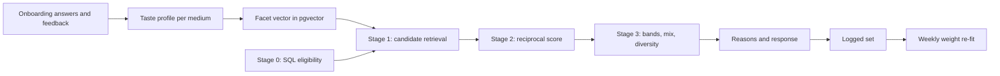
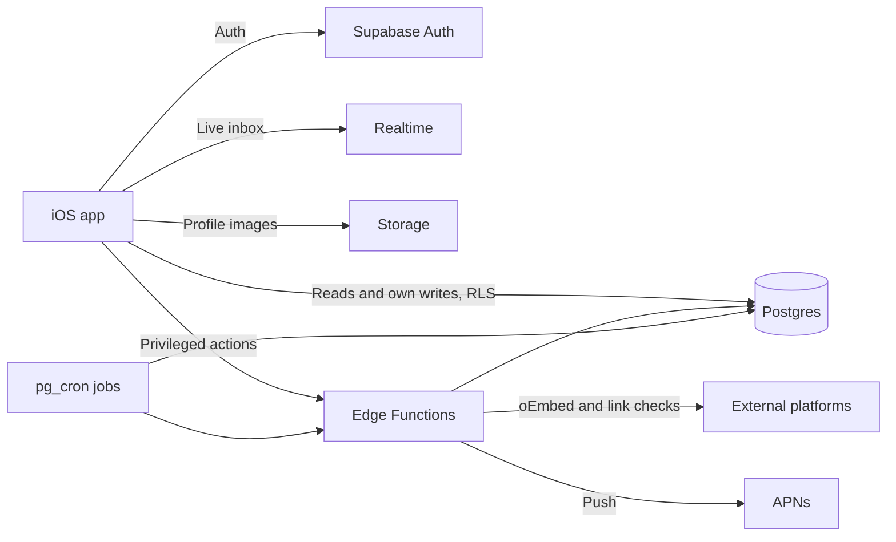

# Notion technical extracts

Related: [[00-what-exists]], [[2026-10-24-notion-source-extracts]]. Used by [[2026-10-25-architecture-concept-v1]].

Fetched 2026-10-25 via the claude.ai Notion connector (`notion-fetch`). All six pages returned `verification.state = unverified` (Notion's page-verification field, not an access failure). No truncation markers returned. Content below is a faithful extract: tables and rules are copied as written; prose is lightly condensed. Mermaid blocks reproduced. Math rendered as plain text.

Precedence reminder: locked decisions in [[2026-10-24-architecture-round-1-interview]] override these pages where they conflict. Conflicts are listed in the concept's reconciliation table, not here.

| Page | URL | Last edited (UTC) |
|---|---|---|
| Supabase Data Model & RLS | https://app.notion.com/p/40358cc06d1b8154a756dfd4733a5b81 | 2026-10-24 16:32 |
| Backend Functions & Jobs | https://app.notion.com/p/40358cc06d1b81b8bbe2caefc10432ea | 2026-10-24 15:42 |
| Recommendation & Taste Algorithm v1 | https://app.notion.com/p/40358cc06d1b814eaf11e0ca373d73f6 | 2026-10-24 16:31 |
| iOS Technical Architecture | https://app.notion.com/p/40358cc06d1b81f282a9c4b15f2f0ac6 | 2026-10-24 15:42 |
| Recommendation System (context) | https://app.notion.com/p/36458cc06d1b818ea8adcd63eb7e841a | 2026-10-24 15:42 |
| Trust & Safety (context) | https://app.notion.com/p/36458cc06d1b81c2977af0523cd81351 | 2026-10-24 15:43 |

---

## 1. Supabase Data Model & RLS

"Updated: October 24, 2026." The Postgres schema for the iOS MVP. Implements the data contract in Onboarding Specification v3.1 and the record list in Storage and Databases. "Migrations live in the repo under supabase/migrations; this page describes intent, and the migrations are the source of truth once written."

### Conventions

- Primary keys are uuid (`gen_random_uuid()`); every user-owned table has `profile_id` referencing `profiles.id` with `on delete cascade`.
- Every table has `created_at` and `updated_at` (trigger-maintained). Soft-deletable tables add `deleted_at`.
- RLS is enabled on every table in the public schema, with no exceptions. A table without policies is unreadable by the app.
- Public data and private data live in separate tables, so a profile can be shown without exposing preferences.

### Enums

| Enum | Values |
| --- | --- |
| realm | film_video, music_sound, visual_arts, mixed_practice |
| intent | start, join, explore |
| serendipity | stay_close, mix_it_up, surprise_me |
| availability_band | under_5, five_to_10, over_10, varies |
| work_mode | local, remote, either |
| compensation_preference | paid, unpaid, either |
| compensation_status | paid, unpaid, either, undecided |
| pairwise_choice | left, right, neither, both |
| source_relation | made, admire, want_to_make |
| link_status | ok, unreachable, hidden |
| project_status | draft, published, filled, closed, expired, hidden |
| request_status | pending, accepted, declined, withdrawn, expired |
| feedback_kind | save, more_like_this, less_like_this, not_my_style, hide |

### Identity and profile

| Table | Key columns | Notes |
| --- | --- | --- |
| profiles (public) | id = auth.users.id, handle citext unique, display_handle, avatar_path, primary_realm, secondary_realms realm[], bio, onboarding_completed_at, discoverable bool default true | What other users may see. Handle check constraint mirrors Auth 2 rules. |
| profile_settings (private) | profile_id, primary_intent, serendipity, availability_band, work_mode, city_id, country_code, city_unlisted, compensation_preference, preferred_project_types text[], discovery_focus text[], onboarding_state jsonb, handle_changed_at | Owner-only. Read by Edge Functions with the service role for ranking. |
| legal_acceptances | profile_id, terms_version, privacy_version, age_confirmed, accepted_at | Insert-only audit of Auth 3. |
| profile_roles | profile_id, role_id, is_primary | 1-3 rows per profile; a partial unique index allows one primary. |
| roles | id, slug, label, realm, is_common | Seeded taxonomy, read-only to the app. |
| project_types | id, slug, label, realm | Seeded taxonomy. |
| cities | id, name, country_code, coarse_lat, coarse_lng | Seeded; coarse coordinates only. |
| reserved_handles | handle citext | Reserved and profanity lists. |

### Taste

| Table | Key columns | Notes |
| --- | --- | --- |
| taste_items | id, realm, media_path, alt_text, descriptors text[], facet_ids text[], license_ref, active | Curated cards. At least 24 active per realm. |
| taste_pairs | id, realm, left_item_id, right_item_id, target_facets text[], active | Each pair separates one or two facet dimensions. |
| taste_seed_selections | profile_id, item_id, selection_order | 3-5 rows from O4. |
| pairwise_answers | profile_id, pair_id, choice, response_ms, is_followup | response_ms is research-only; no ranking job reads it. |
| taste_facets | profile_id, facet_family, value, medium, strength, confidence, source_type, source_id, explicit_or_inferred, consent_state, last_confirmed_at, hidden_at, deleted_at | Schema from Taste Capture Strategy. |
| taste_vectors | profile_id, medium, embedding vector, updated_at | pgvector with an HNSW index; one row per medium plus one bridge row (shared families only). |

### Portfolio sources

| Table | Key columns | Notes |
| --- | --- | --- |
| portfolio_sources | profile_id, source_type, canonical_url, external_id, display_title, media_type, source_relation, user_declared_facets jsonb, public_display_consent bool default false, recommendation_use_consent bool default false, consent_updated_at, link_status, failed_checks int, last_checked_at | Mirrors the connector/linking spec. Others see a row only when public_display_consent is true. |
| references | id, kind (film, album, track, artist, label, director), canonical_key, title, year, creator, country, genres text[], tags text[], external_ids jsonb, facet_hints jsonb, list_count | Shared catalogue, one row per real-world reference; list_count drives rarity weighting. |
| profile_references | profile_id, reference_id, source_id, relation (made, admire, want_to_make), position | Replaces letterboxd_favorites. Up to 5 per Letterboxd and Bandcamp source, 3 per Spotify source, 3 labels. Inherits consent from source_id. |
| release_credits | profile_id, source_id, credited_name, matched_profile_id, confirmed_by_both | Credits from a musician's own Bandcamp page; used only after both confirm. |
| consent_events | profile_id, source_id, control, new_value, changed_at | Insert-only audit. |

### Projects and requests

| Table | Key columns | Notes |
| --- | --- | --- |
| projects | id, owner_id, status, project_type_id, project_type_other, realm, title, description, compensation_status, work_mode, city_id, starts_on, ends_on, expires_at, published_at | Check constraint: a published project cannot have compensation_status = undecided and needs title and description. |
| project_roles | project_id, role_id, status (open, filled) | At least one before publishing. |
| project_references | project_id, url, label | Links only; no hosted media. |
| requests | id, sender_id, recipient_id, project_id, project_role_id, idea_text, message, status, decline_reason, created_at, resolved_at | Needs project_id or idea_text. Partial unique index blocks a second pending request for the same sender, recipient and project. |
| conversations, conversation_participants, messages | conversation per accepted request; messages with body text, sent_at, read_at | Created only by the respond-request function. |
| device_tokens | profile_id, apns_token, environment | For push. |

### Feedback, outcomes, safety

| Table | Key columns | Notes |
| --- | --- | --- |
| recommendation_feedback | profile_id, target_type, target_id, kind, set_id | Saves, hides, more/less like this, not my style. |
| collaborations, collaboration_participants | project_id, proposed_by, status; participant confirmed_at | A collaboration counts when the owner proposes and one other participant confirms. |
| made_together_posts | collaboration_id, title, links, credits, published_at | Only from a confirmed collaboration. |
| blocks | blocker_id, blocked_id | Enforced in every read policy and in ranking. |
| reports | reporter_id, subject_type, subject_id, category, context, urgency, status | Reporter can insert and read their own; moderators via service role. |
| moderation_actions, appeals | case, action, reason, actor, timestamps | Admin-only; never exposed through PostgREST. |

### Recommendations and analytics

| Table | Key columns | Notes |
| --- | --- | --- |
| recommendation_sets | id, profile_id, surface, rules_version, eligible_count, created_at | One per rendered set. |
| recommendation_items | set_id, candidate_type, candidate_id, rank, component_scores jsonb, band, reasons text[], suppression_reason, consent_snapshot jsonb, scorer_version, d_viewer_to_candidate, d_candidate_to_viewer | Logging required by Product Analytics. Service role only. |
| analytics_events | event_id unique, name, occurred_at, profile_id or anonymous_session_id, app_version, surface, properties jsonb | Partitioned by month. Insert only through the track function. |

### Row Level Security

| Table | Select | Insert / update / delete |
| --- | --- | --- |
| profiles | Authenticated users, where onboarding is complete, discoverable is true and no block exists in either direction; always your own row | Own row only; handle changes limited to once per 30 days by trigger |
| profile_settings, legal_acceptances, taste_*, consent_events | Own rows only | Own rows only (legal and consent tables insert-only) |
| portfolio_sources, profile_references | Own rows; others only when the source's public_display_consent is true and no block | Own rows only |
| references | Everyone (catalogue data, no personal information) | Service role only |
| projects, project_roles, project_references | Published projects for everyone not blocked by the owner; drafts only to the owner | Owner only |
| requests | Sender or recipient | Insert only through send-request; status changes only through respond-request |
| conversations, messages | Participants only | Participants insert messages; no edits after 15 minutes |
| recommendation_feedback, blocks | Own rows | Own rows |
| reports | Own submitted reports | Insert own |
| recommendation_*, analytics_events, moderation_*, appeals | None (service role only) | Service role only |

"A shared SQL function is_blocked(a, b) is used in every relevant policy so block behavior cannot drift between tables."

### Retention (proposed defaults, confirm before beta)

| Data | Proposed retention |
| --- | --- |
| Messages | Life of the account; deleted 30 days after account deletion |
| Recommendation logs | 180 days |
| Analytics events | 13 months, pseudonymized |
| Moderation evidence | 1 year after case closure, unless under legal hold |
| Disconnected connector metadata | Deleted within 24 hours; consent audit row kept |
| Backups | Supabase point-in-time recovery window (7 days) |

"Storage and Databases asks for these to be documented before beta; they are proposals until confirmed."

---

## 2. Backend Functions & Jobs

"Updated: October 24, 2026." Every server-side operation the iOS app calls, plus scheduled jobs.

### Principles

- The app writes its own rows directly through RLS. Everything else goes through one of the operations below.
- Every function verifies the caller's JWT, returns typed JSON errors (code plus message), and is idempotent where the client may retry.
- Rate limits are enforced server-side, never in the app.

### Database functions (RPC) — "Called with supabase.rpc. Security definer, with a fixed search_path."

| Function | Purpose | Notes |
| --- | --- | --- |
| handle_available(text) | Debounced availability check for Auth 2 | Returns available, or a reason code (taken, reserved, invalid_format). |
| set_handle(text) | Claim or change a handle | Enforces format rules, reserved list, and once-per-30-days changes. |
| save_onboarding_step(step, payload) | Save after every step | Validates the payload for that step and updates onboarding_state. |
| block_user(uuid) | Block in both directions | Withdraws pending requests between the two users immediately. |
| submit_report(subject_type, subject_id, category, context) | Report anything user-generated | Sets urgency; never auto-bans. |
| record_feedback(target_type, target_id, kind, set_id) | Save, hide, more/less like this, not my style | Feeds Taste Capture behavioral learning. |

### Edge Functions

| Function | Called when | What it does |
| --- | --- | --- |
| complete-onboarding | User taps Enter Kizuki on C4, or skips | Validates answers; writes taste facets from seed and pairwise answers; creates the project draft for Start users; returns the C4 preview set. |
| recommendations | Discover, Projects, People, and the C4 preview | Runs Stage 0-1 in one SQL call, then Stage 2-3 scoring, bands, mix, diversity and reasons in TypeScript; logs the set and items; returns 2-4 reasons per card. Empty result when fewer than 3 pass the threshold. |
| validate-link | User adds a portfolio source in C3 or You | Checks format and platform, checks public reachability, fetches public oEmbed metadata where terms allow, returns a preview. Never scrapes or fetches behind a login. |
| send-request | User sends a request | Requires verified email, primary role and the action's required fields (else returns missing_fields so the app shows one sheet); checks blocks, duplicates and rate limits; enforces the compensation filter. |
| respond-request | Recipient accepts or declines | Accept creates the conversation and participants; decline stores an optional reason. Sends push to the sender. |
| publish-project | Owner publishes a draft | Validates title, description, at least one role, and a decided compensation status; moderates the Other type text. |
| propose-completion, confirm-completion | Closing the loop | Creates and confirms collaborations; enables Made Together. |
| track | Analytics batch from the app | Validates event names against the taxonomy; drops forbidden fields (URLs, free text, location); dedupes on event_id. |
| send-push | Database webhook on new request, acceptance or message | Sends APNs notifications; removes invalid tokens. |
| export-account | User requests a data export in Settings | Produces a JSON archive and a signed download link valid for 24 hours. |
| delete-account | User deletes their account in Settings | Required by App Store rules. Deletes auth user and cascades; schedules messages and logs for the retention rules. |

### Rate limits (beta defaults)

| Action | Limit |
| --- | --- |
| New requests, account under 7 days old | 5 per day |
| New requests, established account | 20 per day |
| Reports | 10 per day |
| Handle availability checks | 30 per minute |
| Link validations | 30 per hour |

"Limits tighten automatically for accounts with open safety cases, per Trust & Safety. Premium never bypasses them."

### Scheduled jobs (pg_cron)

| Job | Schedule | Action |
| --- | --- | --- |
| expire-projects | Hourly | Marks published projects past expires_at as expired. |
| expire-requests | Daily | Marks pending requests older than 14 days as expired. |
| recheck-links | Weekly | Rechecks public portfolio links; hides a link after 2 failed checks and notifies the owner in-app. |
| project-draft-reminder | Daily | Sends one reminder for drafts still unpublished 3 days after onboarding. |
| purge-deleted | Daily | Applies retention rules to deleted accounts and disconnected sources. |
| refresh-taste-vectors | Every 15 minutes | Recomputes vectors for profiles whose facets changed. |

### Error codes the app must handle

`unauthenticated`, `email_not_verified`, `missing_fields` (with a field list), `blocked`, `duplicate_request`, `rate_limited` (with retry_after), `not_found`, `validation_failed` (with field errors), `server_error`.

---

## 3. Recommendation & Taste Algorithm v1

"Updated: October 24, 2026."

### Decision

"Kizuki builds its own recommendation and taste-capture algorithm. v1 is deterministic, explainable, and runs entirely in Postgres (pgvector) and the recommendations Edge Function. No external model is used. Weights start as hand-set priors and are re-fit from logged outcomes once there is enough data." Numbers are beta defaults to tune.

### Part 0 — what it optimises for (condensed)

- "Kizuki is not a feed. A good set is three to five people or projects the user would be glad to have met, where the other side would be glad too."
- Meaningful connection = same sensibility, different craft. Taste similarity on shared families (mood, pacing, density, texture, narrative tendency, process) and concrete shared references. Specific/rare shared reference > abstract trait. Role complementarity scored positive; same-role pairs not hidden. Reciprocity via harmonic mean.
- Prospect quality from behaviour (answered requests, confirmed collaborations, published project with context, recent voluntary activity, verified email, consented portfolio). "Never from followers, saves received, profile views, or how often someone is recommended." Responsiveness is a prospect signal. Project context beats profile polish.
- Serendipity: **common-thread rule** — a stretch or adjacent pick is allowed only if at least one is true and shown as a reason: shared specific reference; shared facet in a shared family with both strengths > 0.3; same city; same project type; complementary role on a live project. "No thread, no pick."
- Taste differs on purpose, logistics do not. Bridge vectors across media. "Small, fresh sets" refreshing daily, not infinite scroll. Exploration budget by serendipity setting + 1-in-10 new-creator exposure floor; ±0.03 jitter within a band. Weak ties after density. Learn stretch share ±10 points from saves/requests vs "not my style".
- Feedback vocabulary: "Not my style" = taste signal; "Hide" = weak; "Not now" (snooze 30 days) = not a taste signal.

### Part 1 — taste model

- Facet taxonomy: 60–120 values grouped into families (composition, color and density, texture, mood, pacing, narrative tendency, process…). Each family tagged medium-specific or shared. Each card/pair tagged 3–8 facet values with weight w in [0,1].
- Profile state per user, medium, facet f: running sum S and evidence count N. `s_f = clip(S_f / (N_f + 2), -1, 1)`; `c_f = N_f / (N_f + 3)`.
- Update rules (signal x × facet weight w added to S; w added to N):

| Event | x | Notes |
| --- | --- | --- |
| O4 card selected | +1.0 | Earlier selections +0.1 extra per position ahead of the last |
| O4 card shown, not selected | -0.1 | |
| Pairwise left/right | chosen +1.0, other -0.3 | Pair's target facets only |
| Pairwise neither | both -0.3 | |
| Pairwise both | both +0.5 | |
| Save | +0.3 | Candidate's facets |
| More like this | +0.5 | |
| Less like this | -0.5 | |
| Not my style | -0.6 | Also -0.2 on candidate's top 3 shared-family facets |
| Hide | -0.2 | |
| Accepted request (either side) | +0.8 | |
| Confirmed collaboration | +1.2 | |
| Portfolio source, rec consent on | +0.4 per declared facet | |

- Behavioural evidence decays with 90-day half-life; onboarding evidence does not decay until edited. Explicit taste-editor edits set s directly and are never overwritten. `response_ms` and safety events never touch the taste model. Consent off → contributions removed within 24h by recompute from event log.
- References (Part 1b): concrete films/albums/tracks/artists/labels/directors per user with relation. Rarity-weighted overlap: `overlap(a,b) = Σ_{r∈Ra∩Rb} log(N/n_r) / sqrt(Σ_{r∈Ra} log(N/n_r) · Σ_{r∈Rb} log(N/n_r))`. Director/artist/label overlap at half weight of exact title. Inferred facets from references capped at confidence 0.3.
- Vector: per medium, one dimension per facet value, entries s_f·c_f, L2-normalised, `taste_vectors` with HNSW (cosine). Bridge vector = shared families only. Project vector = owner profile blended 50/50 with project reference facets.
- Pairwise follow-ups: after 3 required pairs, if triggered, pick unseen pair maximising `gain(p) = Σ_{f∈targets(p)} (1 - c_f)·|w_left,f - w_right,f|`.

### Part 2 — scoring

- Stage 0/1: SQL eligibility, then up to 200 candidates per source (role index, taste-vector neighbours, bridge neighbours, local, remote, new creators), de-duplicated.
- Stage 2 components (each 0..1); directional D(a→b):

| Component | Weight | Computation |
| --- | --- | --- |
| Role (R) | 0.30 | 1.0 if b's primary role fills an open role a needs; 0.8 secondary role; 0.4 adjacent role. Creator→creator: 1.0 complementary, 0.5 same role. |
| Taste (T) | 0.25 | 0.6 × facet similarity + 0.4 × reference overlap. Confidence-weighted cosine (bridge across media) mapped to 0–1, shrunk toward 0.5 by average confidence; reference overlap 0.5 when either side has none. |
| Complementarity bonus | up to +0.05 | Primary roles complementary (different role, same/adjacent realm) and viewer intent Start or Join. |
| Logistics (L) | 0.20 | Average of work mode (1.0 match, +0.1 same city, cap 1), availability (same band 1.0, neighbouring 0.7, varies 0.8, two apart 0.4), timeframe (overlap 1.0, unknown 0.7). |
| Intent (I) | 0.15 | Start→Join 1.0, Start→Start 0.6, anything with Explore 0.5; +0.2 if project type in a's preferred types, cap 1. |
| Trust & freshness (F) | 0.10 | Average of verified email (1.0 else 0.6) and freshness: exp(-days since last voluntary activity/30) for people, exp(-project age days/21) for projects. |

`D(a→b) = 0.30R + 0.25T + 0.20L + 0.15I + 0.10F`; `score(a,b) = 2·D(a→b)·D(b→a) / (D(a→b) + D(b→a))`. "Results below 0.35 are not shown." Cold start: viewer avg facet confidence < 0.3 → taste weight 0.10, remaining 0.15 split between Role and Logistics.

- Stage 3 bands (raw taste cosine before shrinkage): Close ≥ 0.6; Adjacent 0.3–<0.6 (or close but one shared family differs > 0.5); Stretch < 0.3 only if R ≥ 0.8, L ≥ 0.6 and common-thread rule satisfied. Then: fill to serendipity mix (e.g. Mix it up 60/30/10); MMR λ = 0.7; exposure floor 1 in 10 for creators joined < 14 days with < 20 impressions; max 2 items per project owner; C4 preview rules (≥1 person, ≥1 project when possible, one adjacent when showing ≥ 4).

- Reasons (pick 2–4 highest-contributing true reasons):

| Reason shown | Condition |
| --- | --- |
| Needs your role | R = 1.0 |
| Your references overlap | Shared facet where both strength×confidence > 0.3 (name the family, e.g. "Similar sense of pacing") |
| Open to the same kind of project | Project type in preferred types, or matching compensation set-up |
| Available in the same window | Same availability band |
| Both in {city} | Same city and local or either work mode |
| Works remotely | Both remote-compatible |
| You both listed {reference} | Shared reference with display consent on both sides; else "You share a favorite film/record" |
| Your references share a {mood} register | Top shared bridge-family facet across reference sets |
| Both support the same scene | Shared followed label, or artists from the same city |
| Worked with someone you worked with | Second-degree link (after density) |
| A stretch pick based on your discovery setting | Band is stretch; always paired with one concrete common-thread reason |

"Never show scores, percentages or the underlying facet strengths."

### Part 3 — learning, evaluation, performance

- Log every set and candidate with component values, band, reasons, scorer version. Weekly logistic-regression re-fit after 500 accepted requests; ship only if better on held-out week. Until then human review of 50 sets/week. Ranking changes behind a holdout.
- Budget: Stage 0+1 one SQL call < 150 ms p95; Stage 2+3 in Edge Function for ≤ 500 candidates < 100 ms p95; whole call < 400 ms p95; cache each viewer's set 10 min; vectors recomputed every 15 min.

---

## 4. iOS Technical Architecture

"Updated: October 24, 2026."

### Decision

Native iPhone app in Swift and SwiftUI on Supabase; Android and web out of scope; replaces React Native. Callout: recommendations are Kizuki's own algorithm, taste vectors in pgvector, scoring/bands/reasons in the recommendations Edge Function.

### Stack

| Layer | Choice | Notes |
| --- | --- | --- |
| Client | Swift 6, SwiftUI, iOS 17+ | Observation (@Observable), Swift Concurrency. |
| Backend | Supabase | Postgres, Auth, Storage, Realtime, Edge Functions, pg_cron. |
| DB extensions | pgvector, citext, pg_cron | Taste vectors, case-insensitive handles, scheduled jobs. |
| Server logic | Supabase Edge Functions (TypeScript, Deno) | Anything needing the service role or third-party calls. |
| Recommendation scoring | In-house algorithm (SQL + TypeScript) | No third-party model. |
| Client SDK | supabase-swift (SPM) | Auth, PostgREST, Realtime, Storage, Functions. |
| Google sign-in | GoogleSignIn-iOS, ID token to Supabase | Native sheet. |
| Apple sign-in | AuthenticationServices, ID token to Supabase | Required when Google is offered. |
| Push | APNs, sent from an Edge Function | "Permission asked only after sending or accepting a request." |
| Crash reporting | To decide | |

### System overview

"Rule of thumb: the app reads through Row Level Security and writes only its own rows directly. Anything that touches another user, ranks candidates, calls an external service, or enforces limits goes through an Edge Function or a security-definer database function."

### App structure

One Xcode project with local Swift packages. App (entry, DI container, root navigation, deep links); Core (Codable models, repositories, Supabase wrapper, analytics client, errors); DesignSystem; Features: Auth, Onboarding, Discover, Projects, People, Inbox, You, Safety.

Patterns: `@Observable` main-actor view models; repository protocols with fakes; one `AppSession` listening to `authStateChanges` driving root (signed out / onboarding / main tabs); TabView Discover/Projects/People/Inbox/You with one NavigationStack per tab and a persistent create action; "No business rules in views."

### Auth

- Apple: hashed nonce, `signInWithIdToken(provider: .apple)`.
- Google: native, `signInWithIdToken(provider: .google)`.
- Email: "signUp with email and password; Supabase sends the verification link. Enable leaked-password protection and a 10-character minimum."
- Account linking: never merge silently. Sessions in Keychain. Never ship the service-role key.

### Onboarding implementation

Finite state machine mirroring v3.1 step map; save after every step with retry/backoff; progress in `profile_settings.onboarding_state` for resume; completion calls `complete-onboarding`.

### Data access

Public reads via PostgREST through RLS. "Recommendation sets always come from the recommendations Edge Function, never from client-side queries." Inbox uses Realtime subscriptions filtered by RLS. Images: `avatars` bucket public read, owner write, compressed client-side to max 1024 px. Taste-card media in a separate read-only bucket.

### Analytics

`Analytics.track(name, properties)` typed against Product Analytics event names; batched every 30 s or on background to the `track` Edge Function with client `event_id`; never URLs, free text or precise location.

### Permissions

Notifications after first sent or accepted request. Location with reduced accuracy only on a Near me tap. Never requested in onboarding: contacts, camera, microphone, precise location, notifications.

### Quality bar and testing

Dynamic Type to accessibility sizes, VoiceOver labels, 44×44 pt targets, Reduce Motion. Crash-free sessions ≥ 99.5% before widening beta. Cold start to first screen < 2 s on iPhone 12. Swift Testing for view models/state machines/repositories; UI tests for Start/Join/Explore, skip, resume; pgTAP for every RLS policy; Deno tests for Edge Functions against a local stack.

---

## 5. Recommendation System (context page, condensed)

- Reciprocal recommender, not a feed. Rules: hard constraints before similarity; mutual fit beats one-sided engagement; project context beats profile similarity; explain reasons, no fake precision; organic ranking cannot be bought; safety overrides ranking.
- Stage 0 eligibility removes: block either way or viewer reported candidate; candidate onboarding incomplete (handle, realm, primary role); project closed/filled/expired/hidden; incompatible required role; **compensation conflict ("people seeking paid work only see paid or open-to-either projects")**; work-mode conflict; candidate turned off "Show me in recommendations"; source consent off; safety suppression. "Availability is never a hard filter at launch."
- Stage 1 pools: role/project-type index, taste neighbours, local, remote cross-disciplinary, new/underexposed; 50–200 per source.
- Weights 30/25/20/15/10 (Role, Taste, Logistics, Intent, Trust & freshness); "Compensation is not scored because Stage 0 already filters it."
- Serendipity mix: Stay close 80/15/5; Mix it up 60/30/10; Surprise me 40/40/20.
- Threshold: reciprocal score 0.35; if fewer than 3 pass, C4 shows empty state.
- Explanations: 2–4 reasons from Needs your role / Your references overlap / Open to the same kind of project / Available in the same window / Both in {city} / Works remotely / A stretch pick.
- Do not use follower count, popularity, protected traits, inferred socioeconomic status.

## 6. Trust & Safety (context page, condensed)

- MVP controls: report profile, project, outcome, request, message; block; request gate before DM; rate limits; spam/scam detection; moderator queue; action reasons; audit trail; appeal intake; community rules; emergency escalation.
- Request safety: every request needs project or collaboration context; prevent active duplicates; limit new requests by risk/account state; recipients can decline without explanation; "Blocks immediately suppress recommendations, requests, and messages both ways."
- Moderation flow: category + optional context → urgency assigned "without auto-banning" → moderator review → dismiss/warn/restrict/hide/suspend/ban → reporter status update → affected user gets a reason → appeal reviewed separately.
- Minors: "Decided October 24, 2026: adult-only launch (18+)… users under 18 cannot continue and their entered data is not stored."
- In-person: city-level location by default; never precise home location; meeting guidance before first local meeting; no identity-verification claims.
- EU: data minimisation, profiling transparency, access/correction/deletion/objection paths, notice-and-action, statements of reason, appeals.
- Non-goals: public star ratings, fully automated bans, public trust score, background checks.
