# Kizuki Figma full walkthrough

Related: [[playbook]], [[00-what-exists]], [[2026-10-24-figma-screen-inventory]], [[2026-10-24-architecture-round-1-interview]], [[2026-10-25-design-tokens]].

Source: https://www.figma.com/design/XIe9K1RrE3wgLnlBJ59p1i/Kizuki-App (fileKey `XIe9K1RrE3wgLnlBJ59p1i`). Read-only. No Figma edits.

> **Update 2026-10-25 (visual pass).** Access is now a Full seat on the copy `nPqXTMCtd3OVZTSU7Y2uN3` (same node ids). Screenshots, variables and design context were pulled. Jump to "Visual pass (2026-10-25)" below. Statements in the older sections that the visuals contradict are marked **SUPERSEDED** with a pointer. Tokens are now in [[2026-10-25-design-tokens]].

## Method and access limits (read first)

> **SUPERSEDED 2026-10-25.** The quota/View-seat limits below no longer apply. Kept as history only. The "needs screenshot" flags below are resolved by the visual pass.

- `create_session` OK (session `0f971837-1874-47f8-a7f4-404460f7de62`).
- `get_metadata` OK for all six pages. Full node trees saved and parsed (layer names, sizes, text-layer names = copy).
- `get_screenshot` succeeded **once** (`1312:8064`). Every later Figma call failed: *"You've reached the Figma MCP tool call limit for your View seat on the Professional plan."* `whoami`: handle Edison, only plan = "CoLab" (starter, Full seat). The Kizuki file sits in a different Professional-plan org where the account has a **View seat** → low MCP quota.
- Consequence: **`get_variable_defs` and `get_design_context` returned nothing. No design tokens were extracted from Figma.** Token table below is marked unverified/visual-only.
- Browser fallback: Playwright opened the file URL → HTTP 403 (not logged in). Not pursued.
- Visual evidence used: the one new screenshot, the four 2026-10-24 exports, and the user-supplied raster exports in `illustrations/`. Everything else is from layer metadata. Layout/colour claims for frames not in those images are **unverified**.
- Text in tables = text-layer names. In Figma these normally equal the rendered copy, but a renamed layer could differ. Treat as near-verbatim, unverified.
- To finish: re-run with an Edit/Dev seat on the owning team, or wait for quota reset, then screenshot the frames flagged "needs screenshot".

## Screenshots available

> **SUPERSEDED 2026-10-25.** 64 screenshots now exist in `figma/` (see the visual pass). The table below is the old layer-only evidence.

| Flow | File | Node | Source |
| --- | --- | --- | --- |
| Home feed |  | `1312:8064` | get_screenshot 2026-10-25 |
| Entry |  | `1526:4399` | 2026-10-24 export |
| Home feed (older capture) | 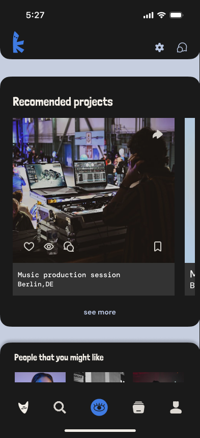 | `1312:8064` | 2026-10-24 export |
| Project detail |  | `1485:5384` | 2026-10-24 export |
| Profile |  | `1312:9852` | 2026-10-24 export |
| Suki tab landing |  | `1361:12184` (name match) | user zip |
| Splash |  | not on `0:1`; name only | user zip |
| Create account |  | `1312:11831`/`1526:4399` (name match) | user zip |
| Taste onboarding |  | not on `0:1` | user zip |

~~Requested per-flow PNGs for onboarding, Search, My Projects, chat, settings, post pages: **not produced** (quota). Only `figma/2026-10-25-home-feed-recommended.png` was saved.~~ **SUPERSEDED:** produced in the visual pass.

## Visual pass (2026-10-25)

Source: App copy `nPqXTMCtd3OVZTSU7Y2uN3`, Full seat, read-only. 64 PNGs in `figma/` (`2026-10-25-<flow>-<screen>.png`). Tokens: [[2026-10-25-design-tokens]]. Illustrations: `illustrations/vector/README.md`.

Capture notes:

- `get_screenshot` returns frames at **1x natural size** (393 px wide) even with `maxDimension` 1600, because the value is only a cap. Frames taller than 1600 px (`1449:4691`, `1312:10050`, `1312:10251`, `1418:3514`) were scaled down to fit, and the 6669 px Components board is small. Ask for 2x via `download_assets` if pixel detail is needed.
- Near-duplicates **skipped** (same layout, different state or fade frame): Splash 2/3 (`1312:11408`, `1312:11784`); loader frames `1312:11226`, `1312:11272`, `1312:11318`; username typing/valid states `1480:4473`, `1480:4590`, second error `1480:4417`; onboarding goal states `1344:10286`, `1344:10032`, `1344:10159`, `1344:11019`; kind states Music/Hybrid/base `1361:11847`, `1361:11680`, `1312:11455`, `1344:11652`; portfolio `1312:12970`, `1312:13012`; Splash 10/12/13/14 (`1361:12309`, `1361:12015`, `1361:12503`, `1418:3435`); chooser `1426:12252`, `1426:12194`, `1426:12310`; photo pickers `1488:6338`, `1385:9271`, `1587:4410` (stock iOS Photos UI); project detail `1449:4238`, `1457:3553`, `1457:3803`, `1459:4300`, `1457:3627`; request form `1485:5674`, `1480:4947`, `1485:5814`; search `1473:5636`; profile edit states `1426:12665`, `1426:12774`, `1426:12883`, `1429:12992`; Privacy default `1312:9004`; Login `1312:11890`; the second Create Account/Profile Picture copies `1312:12172`, `1312:11831`.
- Not captured and not needed: stock keyboard/status-bar/Apple Pay components, the 2026-05-26 screenshot pastes (`1314:15769`), and pages 3 to 6 (layer-only above).

### Look and feel (visual)

- Dark-only, neobrutalist, hand-drawn: charcoal `#1A1A1A` surfaces, cream text, torn zigzag top edges on onboarding headers, rough-edged cards, hard offset shadows on buttons, film-strip frame on project heroes, black-line character art. Home and Profile put dark rounded cards on a baby-blue `#C6CEDF` canvas; Search, Chat, Settings, Onboarding are full charcoal; Suki/project screens are near-black.
- Four display fonts are in play: Londrina Solid (titles), DM Mono (buttons, tags, project text), DM Sans (cards, chat, settings), Poppins (forms, bio).
- No light mode exists on any app frame.

### Entry and account creation

| Screen | Node | Screenshot |
| --- | --- | --- |
| Splash 1: orange swirl, black crest logo | `1312:11087` | 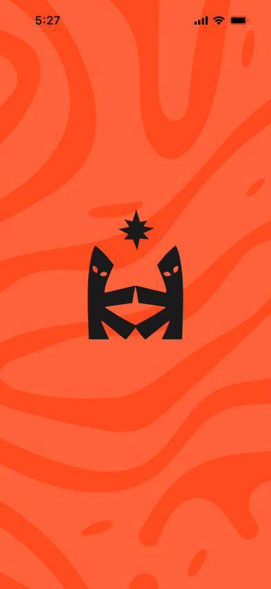 |
| Splash 4: fade frame into Create Account | `1344:9590` | 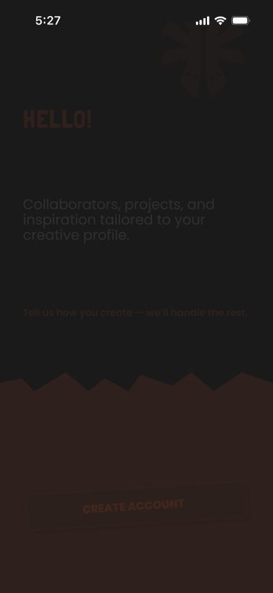 |
| Create Account (Ink `#371F1D` background) | `1526:4399` | 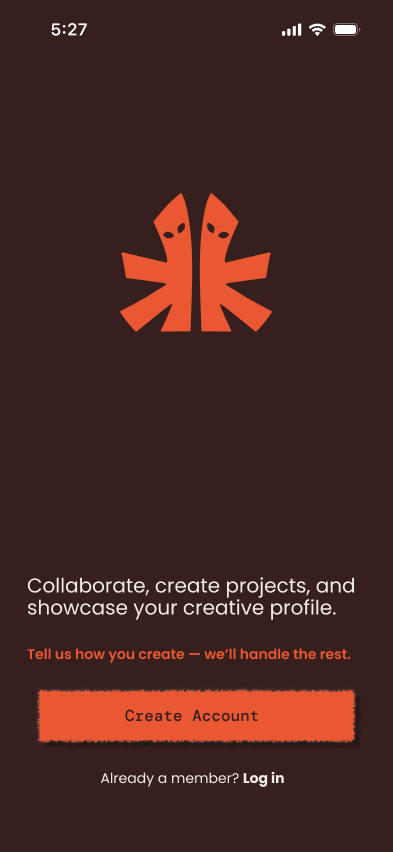 |
| Login with Apple / Google | `1312:11854` | 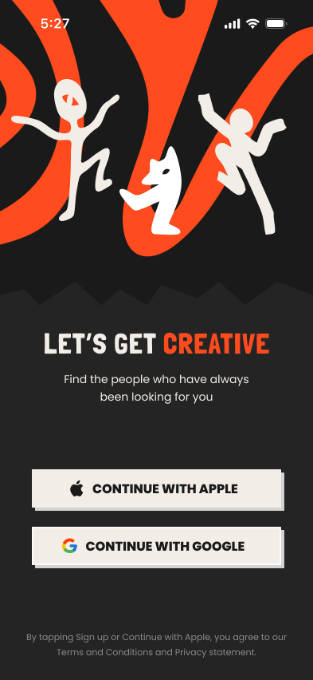 |
| Splash 5: near-black fade | `1312:13206` | 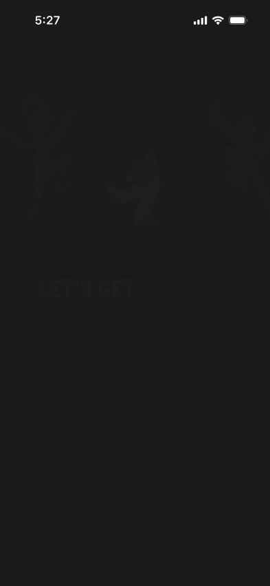 |
| Username (empty) | `1480:4256` | 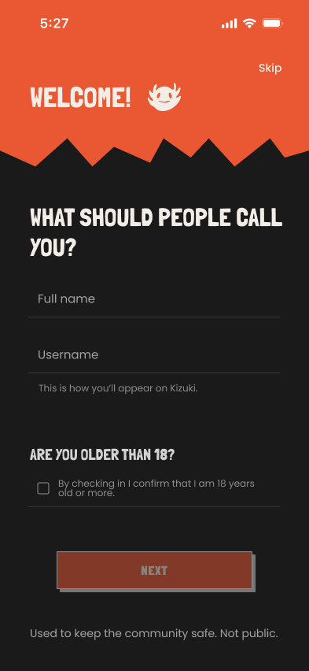 |
| Username taken error | `1480:4367` | 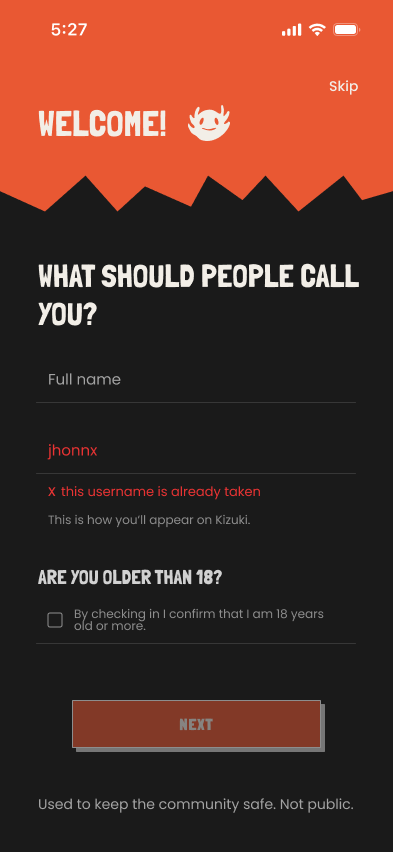 |
| Age gate error | `1480:4652` | 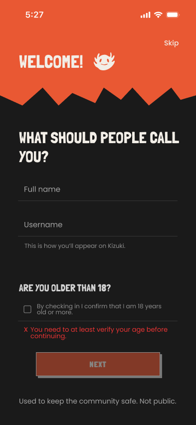 |
| Profile picture | `1587:4579` | 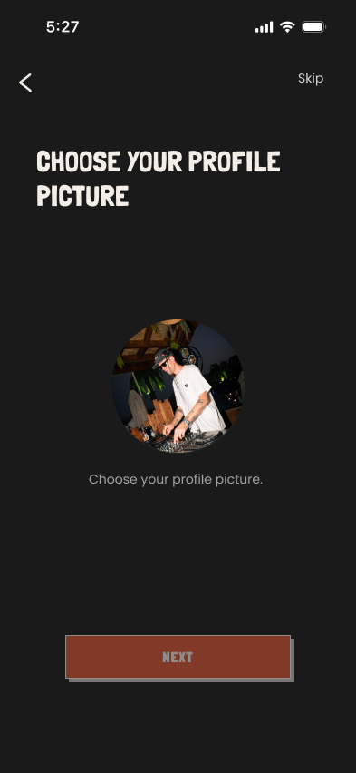 |
| Photo crop dialog | `1312:11996` | 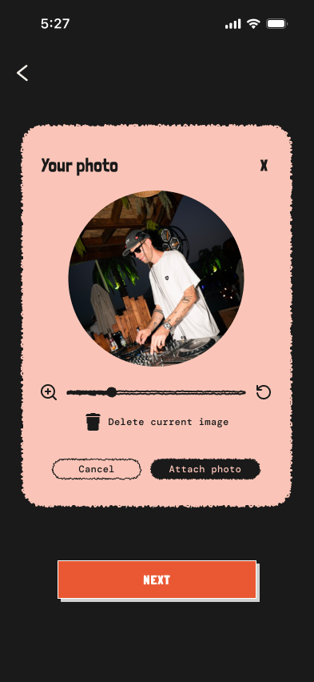 |

- Create Account screen has **Create Account** + "Already a member? Log in" only. No email/password UI (matches earlier finding). Apple/Google buttons are cream with an offset shadow; Google is present (conflict stays).
- The username screen has a **Skip** link top-right and a disabled NEXT button; the age checkbox sits below. Skip also appears on the profile picture, location, and every onboarding screen. Account creation cannot be skippable.
- Errors are red text with an "X" prefix, under the field.

### Onboarding

| Screen | Node | Screenshot |
| --- | --- | --- |
| Goal (2 cards) | `1312:12209` | 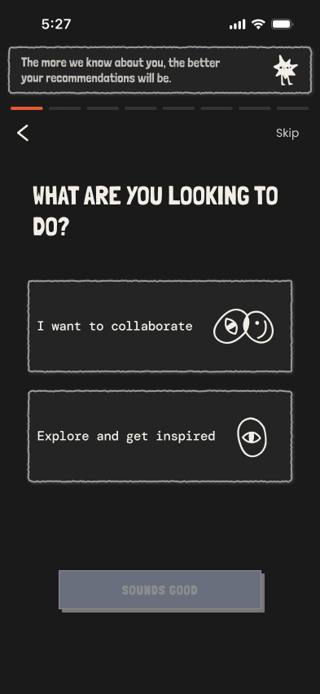 |
| Project kind: Visual Arts open | `1344:11498` | 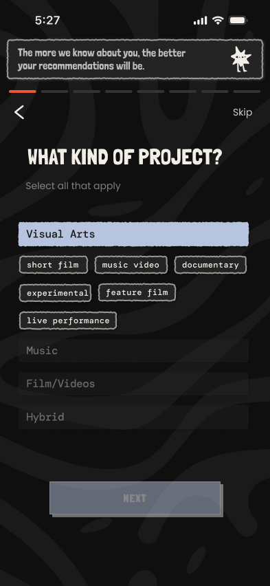 |
| Project kind: Film/Videos open | `1344:11806` | 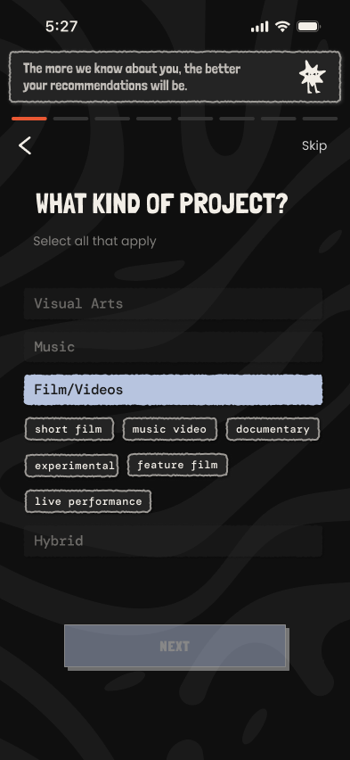 |
| Who to bring on board | `1336:15975` | 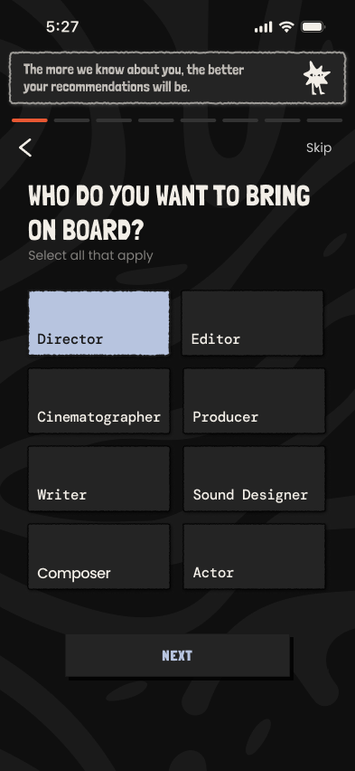 |
| Your role | `1336:16105` | 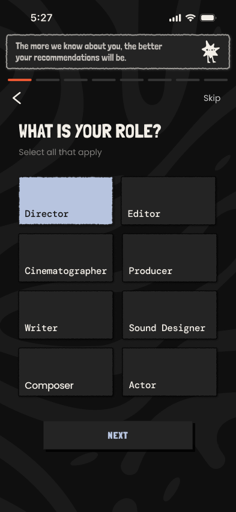 |
| How do you want to work | `1312:12351` | 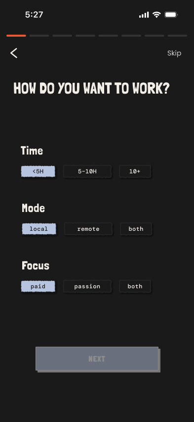 |
| Connect socials | `1312:12814` | 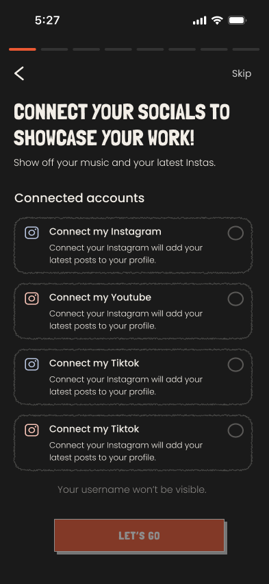 |
| Location / notifications | `1312:13188` | 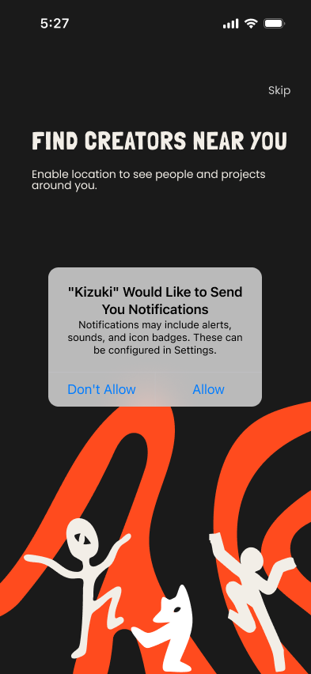 |
| Loader "Building your creative space..." | `1312:11134` | 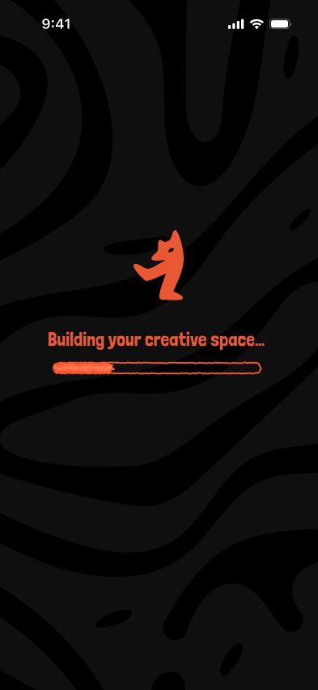 |
| Welcome | `1312:11364` | 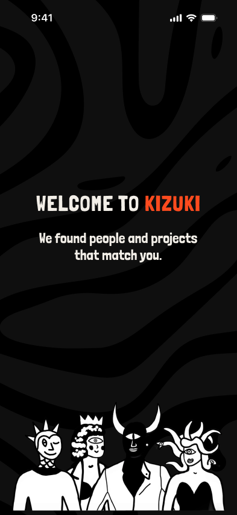 |

- Order in file: goal, kind, bring-on-board, role, work prefs, socials. The location screen is annotated before login and sits outside the 8-step bar.
- "What kind of project?" is an accordion: Visual Arts / Music / Film/Videos / Hybrid; the expanded sub-options (short film, music video, documentary, experimental, feature film, live performance) are the **same film-biased list under every realm**. Role grids list only film roles (Director, Editor, Cinematographer, Producer, Writer, Sound Designer, Composer, Actor) for both "bring on board" and "your role". Placeholder content, not a taxonomy.
- Work prefs: Time `<5H` / `5-10H` / `10+`; Mode local / remote / both; Focus paid / passion / both. Chips are mono text. This matches the planned availability/mode/compensation fields.
- Socials: four rows (Instagram, YouTube, TikTok, TikTok) all with Instagram copy and Instagram glyphs. Placeholder.
- Welcome screen uses a 4-portrait illustration that is a **third-party reference screenshot** (see illustrations README). It must be replaced by owned art.

### Home tab

| Screen | Node | Screenshot |
| --- | --- | --- |
| Feed (recommended + people) | `1312:8064` |  |
| Feed, scrolled | `1467:4643` | 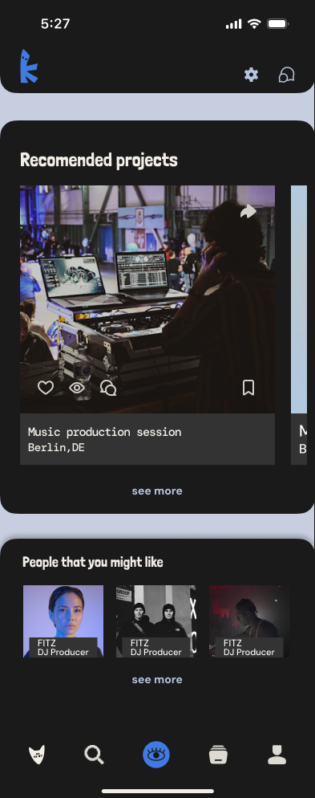 |
| Projects, For You | `1468:4887` | 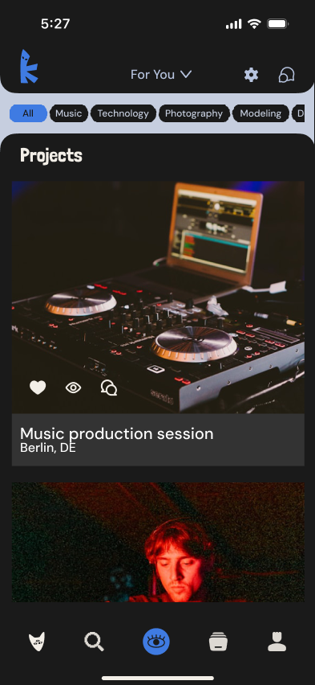 |
| Projects, Following | `1468:5176` | 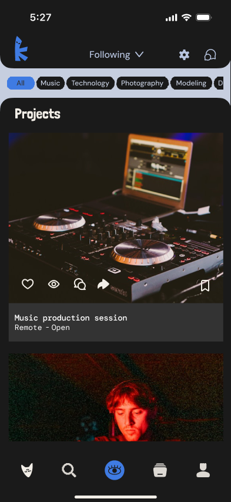 |
| People grid | `1473:5741` | 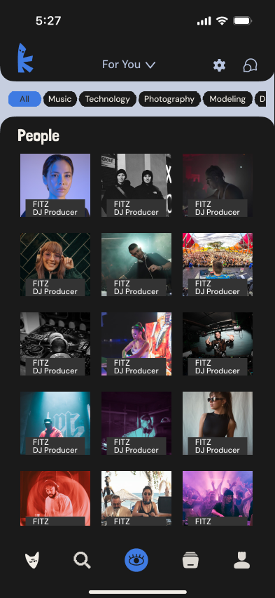 |

- Header: blue K logo (left), settings gear and DM icon (right). In the Projects/People variants the **For You / Following** control is centred in the header.
- The feed has two forms: the "cards" home (`1312:8064`) and the full-height Projects/People lists. How a user switches from the cards home to the lists is not drawn ("see more" is the likely link).
- Project card meta differs between variants ("Berlin, DE" vs "Remote - Open") and action icons differ (share+save appear only in the Following variant).

### Search tab

| Screen | Node | Screenshot |
| --- | --- | --- |
| Collab grid + chips | `1312:9342` | 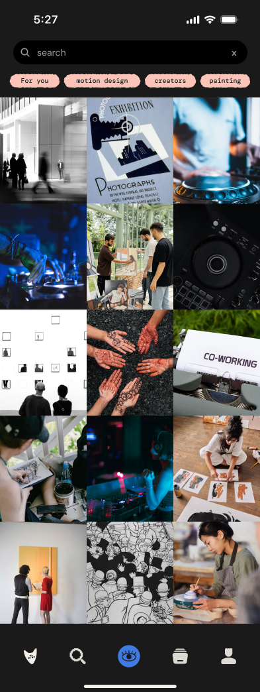 |
| Opened post (full-bleed) | `1468:5306` | 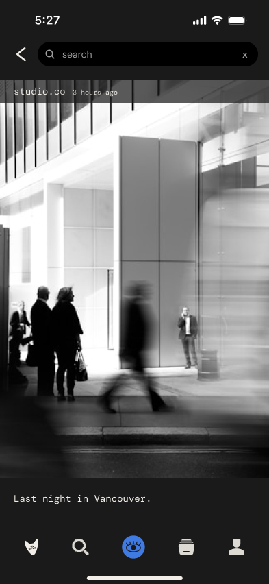 |
| Post overlay (other post) | `1473:5533` | 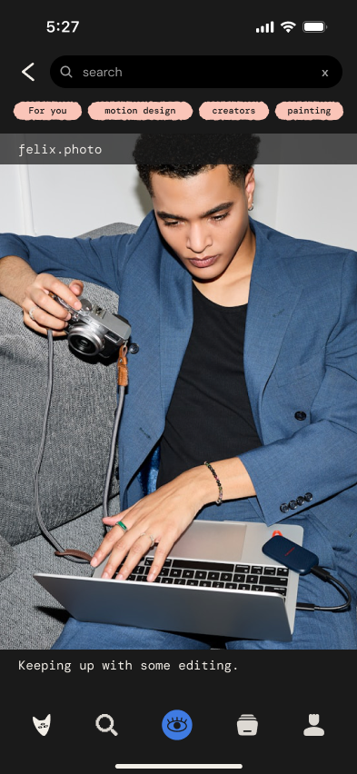 |
| Name search + Recent | `1312:9406` | 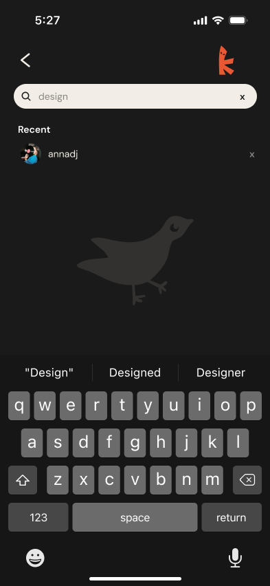 |

- Grid is full-bleed, 3 columns, no gutters; chips are salmon pills (For you, motion design, creators, painting); search field is a black pill with a clear "x".
- Opened post: author + "3 hours ago" top-left, caption bottom, back arrow beside the search field. No like/save/request on the post, no way back to the profile or project.
- Name search is a separate screen: **cream** search field, "Recent" with `annadj`, a bird illustration as empty-state art, keyboard up, **tab bar hidden**, orange K logo.

### Suki tab and create flows

| Screen | Node | Screenshot |
| --- | --- | --- |
| Get Started landing | `1361:12184` | 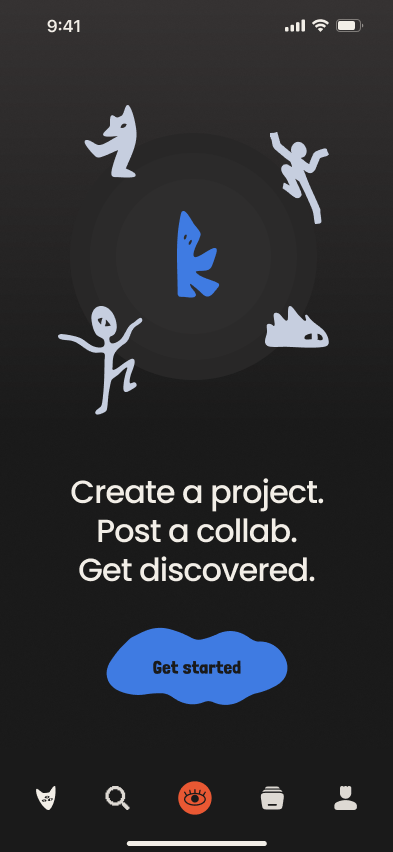 |
| Chooser: Get discovered / Create a project / Post a collab | `1361:12435` | 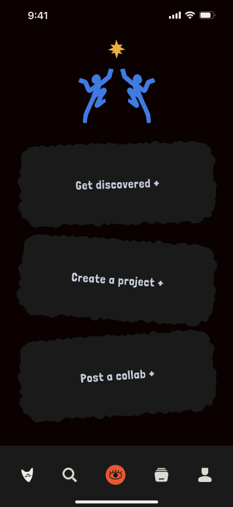 |
| Chooser variant (collab only) | `1426:12602` | 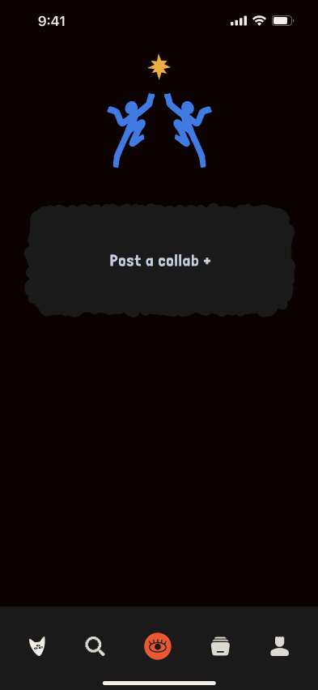 |
| Create a project form | `1361:12567` | 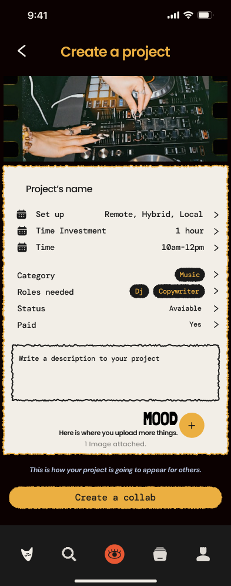 |
| Post a collab: caption | `1385:9327` | 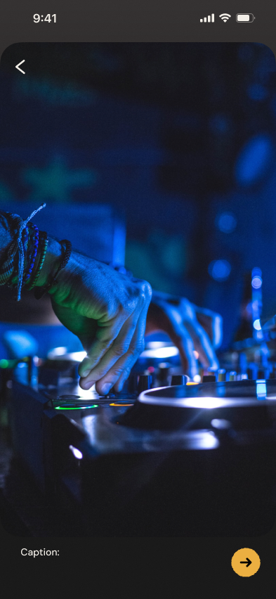 |
| My Collabs grid | `1418:3318` | 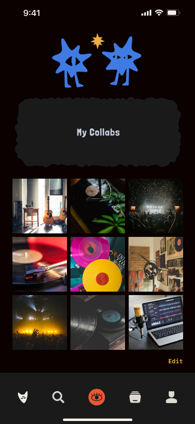 |
| Get discovered intro | `1411:3033` | 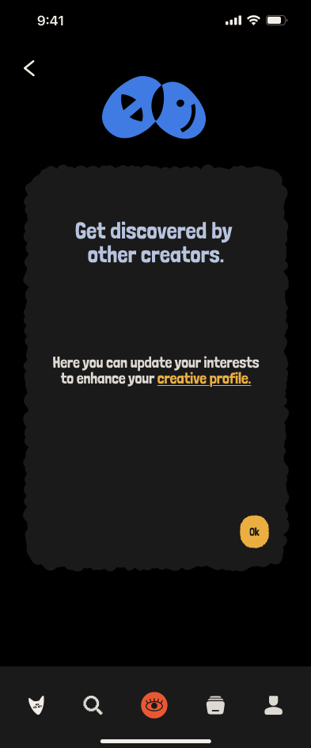 |
| Update creative profile (long form) | `1418:3514` | 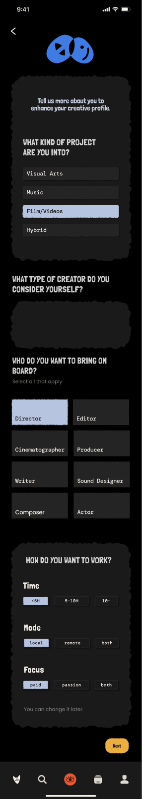 |
| Connect socials (empty card) | `1423:11185` | 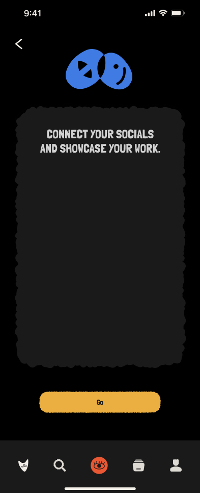 |

- Flow (inferred from the visuals, not prototype links): landing "Get started" -> chooser. "Post a collab" -> iOS Photos picker -> caption (yellow arrow) -> collab appears in "My Collabs". "Create a project" -> form. "Get discovered" -> "update your interests" intro -> creative-profile form -> connect socials.
- Create form fields: name, hero image, Set up (Remote/Hybrid/Local), Time Investment, Time, Category, Roles needed, Status, Paid, description, MOOD image upload, CTA "Create a collab" (yellow). `Paid: Yes` and a status "Avaiable" typo.
- The "Update creative profile" form is a long sheet of dark blobs: kind of project, creator type (a **blank** box), bring on board, how do you want to work. It reuses onboarding components.
- The Suki tab in Figma is therefore a **creation hub**. No matches and no requests anywhere in it (unchanged gap vs decision #19).

### Project detail and request

| Screen | Node | Screenshot |
| --- | --- | --- |
| Detail, open (Collab / View more) | `1449:4146` | 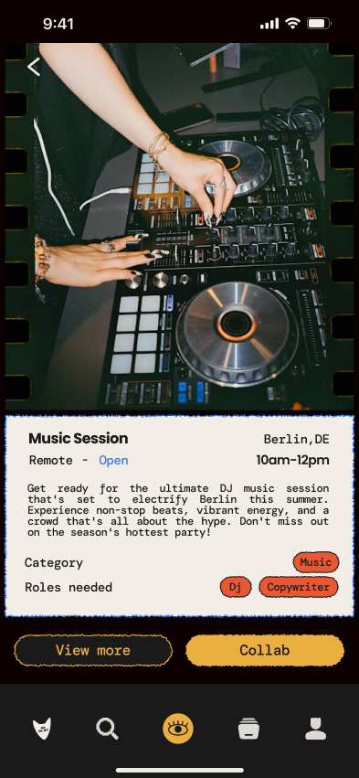 |
| Detail with action row | `1485:5384` | 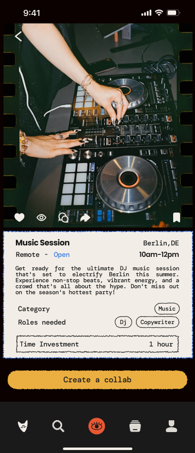 |
| Detail, closed | `1485:6118` |  |
| Detail, scrolled (collaborators, comments, more like this) | `1449:4691` | 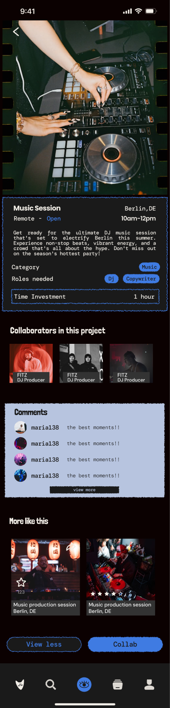 |
| Comments sheet | `1478:3770` | 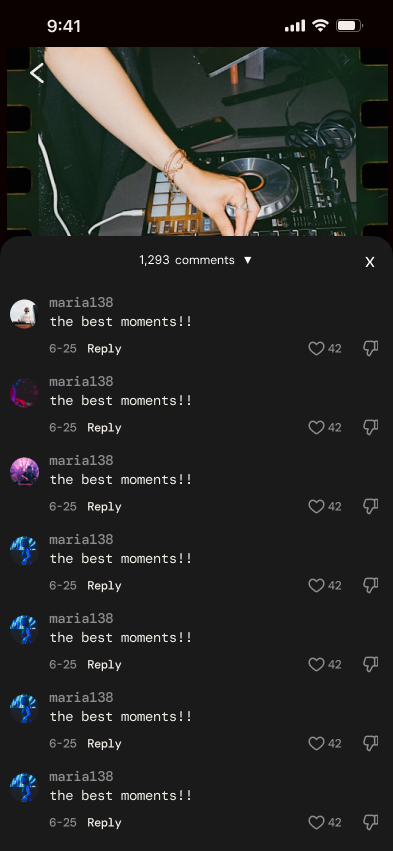 |
| **Collab request form** (role, time, notes, payment) | `1480:4806` | 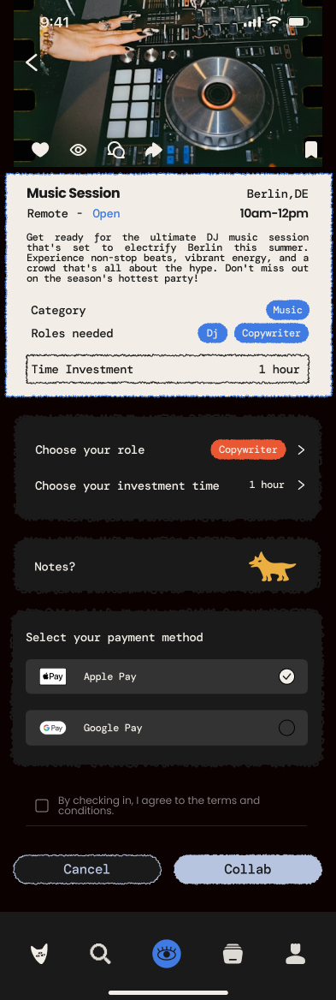 |

### My Projects tab

- Still **no frame**. The only references are the tab icon and the Profile "Projects I created / Collabs / Starred" blocks.

### Profile tab

| Screen | Node | Screenshot |
| --- | --- | --- |
| Bio tab | `1312:9852` | 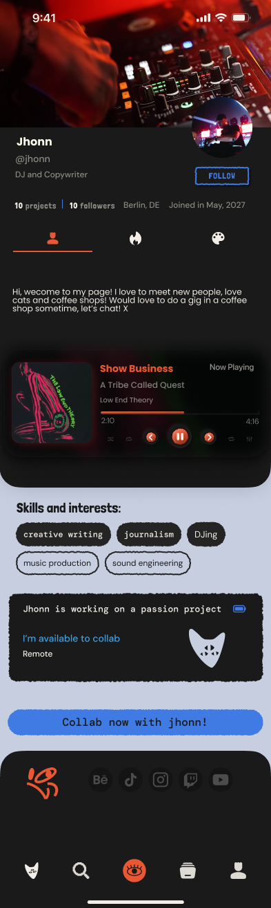 |
| Bio tab, alt tab-bar icons ("add banners") | `1423:11992` | 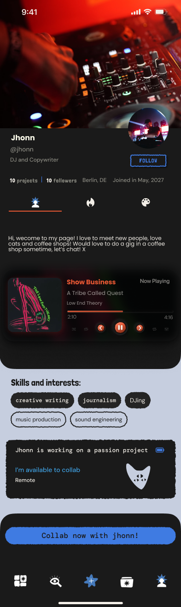 |
| Projects tab | `1312:10050` | 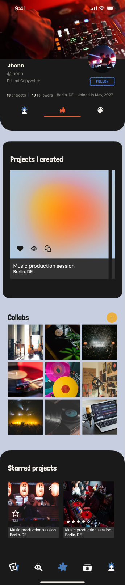 |
| Portfolio tab | `1312:10189` | 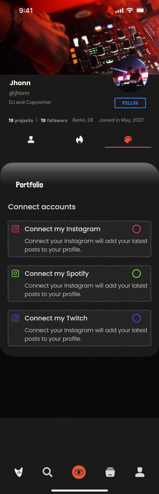 |
| Own profile, empty state | `1312:10251` | 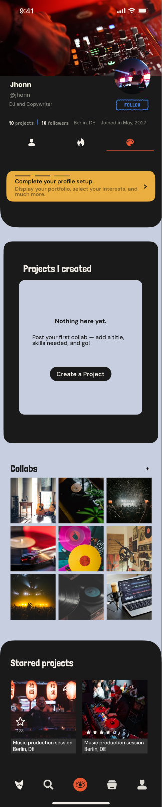 |

- Bio tab content: cover photo, round avatar, name, handle, role line, FOLLOW, "10 projects | 10 followers", city, joined date, bio, a **Now Playing** music widget, skills and interests chips, availability card (battery icon, "I'm available to collab", "Remote", fox glyph), CTA "Collab now with jhonn!", social icon row (Behance, TikTok, Instagram, Twitch, YouTube).
- Own-profile state does not exist as a header. Edit entry point not drawn.
- `1312:10050` and `1423:11992` show a **different tab-bar icon set** (sparkle/star glyphs). Treat as an alternate/abandoned icon style until confirmed.

### Chat

| Screen | Node | Screenshot |
| --- | --- | --- |
| First state (empty) | `1312:10709` | 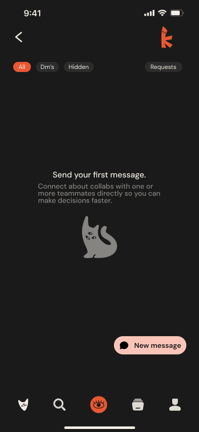 |
| List | `1312:10492` | 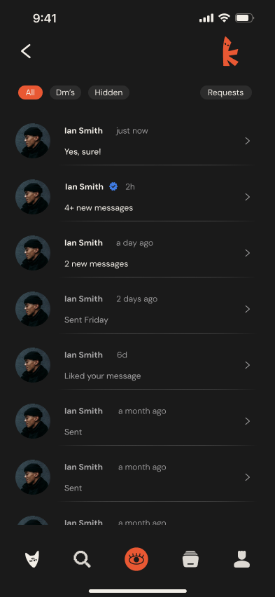 |
| Search | `1312:10773` |  |
| Thread | `1312:10374` |  |

### Settings

| Screen | Node | Screenshot |
| --- | --- | --- |
| Root | `1312:8654` |  |
| Profile & Account | `1312:8799` |  |
| Notifications | `1312:8901` |  |
| Privacy: who can message me | `1312:8951` |  |
| Privacy: block & report | `1312:9053` |  |
| Collaboration Preferences | `1312:9104` |  |
| Connected Apps (placeholder) | `1312:9152` |  |
| Language & Region | `1312:9203` |  |
| Help & Support | `1312:9248` |  |
| Legal & About | `1312:9294` |  |

### Components

`1290:7947` is a loose board: back/forward chevrons, two **radio-list** variants (the "Dropdown/select": "why my friends / only my friends" rows, not a dropdown), small icons, a Tab Bar instance, a vertical rail, Apple/Google Pay buttons, iOS Photos screens. Individual component specs are in [[2026-10-25-design-tokens]].

### Corrections to the layer-only findings

1. **Access/method**: now Full seat; quota blocks gone. (Method section superseded.)
2. **Suki chooser labels** are "Get discovered +", "Create a project +", "Post a collab +", not "Post / New project / Update my interests". `1418:3318` is "My Collabs", not a composer.
3. **The "payment sheet" is a collab request form** (role, investment time, notes, then payment). The request-to-join UI exists; only the payment block is out of scope.
4. **Location screen** shows a *notifications* alert. No location alert is drawn.
5. **Onboarding goal** has two options ("I want to collaborate", "Explore and get inspired"), not a Start/Join/Explore split.
6. **Suki mascot appears in onboarding** (banner on goal, kind, bring-on-board and role screens).
7. **Who can message me** is a two-option radio ("anyone", "only my friends"), not a dropdown. "Friends" is a concept with no feature behind it.
8. **People grid** is 3 visible columns; the 4th tile is clipped. Chip labels are readable (All, Music, Technology, Photography, Modeling, Developers).
9. **Splash 4 and 5** are fade frames, not content screens.
10. **Profile Portfolio tab** shows connector rows, not a portfolio grid.
11. **Tab-bar eye colour** varies per frame (blue, orange, yellow) and does not mark the active tab (it is orange on Settings and Profile too). The active tab has no distinct state in the renders. A second sparkle-style icon set exists on two profile frames.
12. **Own-profile frame** (`1312:10251`) still has the other-user header.
13. **Settings**: only Notifications has controls; five other pages are label-only stubs; toggles are iOS-system green, not brand.
14. **Tokens**: `Ink` is `#371F1D`; accent is `#E95833`; `#FF6139`, Dusty Blue and the nine Secondary colours do not appear as app variables.
15. **Welcome-screen art is not owned**: the four portraits are a crop of another app's screenshot (`IMG_6719`).
16. **`icon 2 1`** is a sheet of 10 blob shapes, not an app icon.
17. **Project cards carry public star ratings and comments** (scrolled detail, Starred projects), beyond the earlier note that only the comments sheet had them.
18. **Skip** appears on account creation, which the layer pass did not surface.

### Updated gaps (still not designed)

1. Suki matches list and incoming/outgoing request inbox (accept/decline/pending).
2. Request state UI after sending (sent, pending, accepted, declined) and the owner's incoming-request view. The composer exists.
3. My Projects tab (drafts, published, past collaborations).
4. Email sign-up/sign-in, forgot password, verify email (only old App/draw).
5. Notification and location primer screens with "Continue" (decision #31); a correct location alert; denial/fallback (manual city).
6. Taste cards (decision #21), city, availability beyond Time/Mode/Focus, compensation wording, realm-specific taxonomies (the current lists are film-only placeholders).
7. Project create: stepper/preview/publish, edit, close roles; Closed-state CTA behaviour.
8. Own-profile header (edit button, no FOLLOW), edit-profile entry, followers list.
9. Chat gated state (opened by an accepted request), project context in thread, report/block, attachments, group chat.
10. Settings: sign out, delete account, blocked users, real controls for 5 stub pages; Connected Apps.
11. Empty/error/loading: feed empty, search no-results, network error, Suki empty.
12. Notifications/activity center.
13. Made Together / completion confirmation.
14. Dynamic Type sizes; light mode (none exists).
15. Skip rules per screen.
16. Search result post -> author/project navigation and actions.
17. Transition from Home cards view to Projects/People lists.

### Updated conflicts with decisions

| # | Figma element | Node(s) | Decision | Change vs older table |
| --- | --- | --- | --- | --- |
| 1 | Payment block (Apple Pay / Google Pay, "checking in" T&C) inside the request form | `1480:4806`, `1485:5674`, `1480:4947`, `1485:5814`, `1446:11447` | No payments v0 | **Narrowed:** drop the payment block and "checking in" copy; keep role + time + notes |
| 2 | "Paid: Yes" on create form; Focus chip "paid/passion/both" | `1361:12567`, `1312:12351` | Compensation is a label only | Decide wording (label ok) |
| 3 | "Who can message me: anyone / only my friends" | `1312:8951` | Chat only after a request is accepted | **Changed:** radio, plus an undefined "friends" concept. Remove the setting |
| 4 | "New message" FAB, "Send your first message", "Requests" tab | `1312:10709`, `1312:10492` | Same | Unchanged |
| 5 | Continue with Google | `1312:11854` | Apple + email | Unchanged (visually confirmed) |
| 6 | Legacy labelled tab bar | various | 5 tabs | Not visible in renders; still in layers |
| 7 | FOLLOW button, "10 followers", "Following" feed filter | `1312:9852`, `1468:5176` | No follows (#24) | Visually confirmed on Home header and every profile frame |
| 8 | Comments (maria138, thumbs-down, 1,293 count) and star ratings | `1449:4691`, `1478:3770`, `1312:10050` | No comments (#25), no public ratings | **Expanded** with star ratings |
| 9 | Event copy ("electrify Berlin", "Auto-join waitlists", "create events") | `1449:4146`, `1312:9104`, `614:9213` | No events | Unchanged |
| 10 | Welcome art is a third-party screenshot | `1312:11364`, `1574:4533` | Rights/ownership | **New** |
| 11 | Skip on account creation | `1480:4256` | Age gate required | **New** |
| 12 | Suki AI assistant settings; Suki AI banner in onboarding | `1312:9104`, onboarding frames | Suki AI out of v0 | Banner is a scripted tip, not AI; the settings row remains out of scope |
| 13 | Notification alert on the location screen | `1312:13188` | #31 primer + system prompt | **New** |
| 14 | Password + mobile phone fields | `1312:8799` | Email + password | Compatible; mobile phone out of scope |

### New open questions

1. Which of the 8 characters map to the four disciplines (visual arts, music, film, performance) and to the "3 neutral" figures? Figma does not label them.
2. Is the Suki banner in onboarding kept (as a static tip) given Suki AI is out of v0?
3. Do we keep the per-section accent colour of the tab eye, or fix one accent?
4. Replace the Welcome art: new commissioned drawings or reuse characters 1-8 (recoloured)?
5. Which CTA wording wins for the request ("Collab", "Create a collab")?
6. Does the Home "cards" layout stay as the landing, with Projects/People lists behind "see more"?

---

## Global observations (page `0:1`)

- Device frame: 393 × 852 (iPhone 16 Pro). Tall frames = scroll content.
- **Bottom tab bar (current design)** = 5 icon-only items, confirmed visually on Home, Project, Profile, Suki landing: mascot head (Home) · magnifier (Search) · eye in filled circle (Suki, centre, blue on Home / orange-red when active) **[SUPERSEDED: the eye's colour is a per-section accent, not an active state: it varies frame by frame: blue on Home, Search grid, scrolled project detail and the request form; orange on the Suki landing/chooser, chat, settings, profile and create form; yellow on `1449:4146`. The "mascot head" is a fox-like creature glyph. A second, sparkle-style icon set exists on `1312:10050` and `1423:11992`. See visual pass.]** · archive box (My Projects) · person (Profile). **Matches user decision.**
- Layer names inside the tab bar are stale: `Home`, `Search`, `Frame 1984077918` (centre), `Create`, `Projects`. Search frames also contain an older, **labelled** tab bar with text "Home | Search | Suki | Create | My Projects" stacked under the newer icon bar (`Rectangle 187237` 393×830 covers it). That older bar has no Profile tab. Ignore it; it is the source of the "old tab names" seen in 2026-10-24 notes.
- Tab Bar component: `1402:11314` → symbol `1402:11313` "Property 1=Default" (393×103). Home icon varies: `mynaui:home-smile-solid` in post flow vs mascot `Group` elsewhere.
- **Home header** (`Nav Bar` instance, symbol `577:7532`, 393×116): Kizuki "k" logo left; settings gear (`material-symbols-light:settings-rounded`) and DM icon (`mynaui:chat-messages`) right. Matches user decision.
- Canvas annotations (huge text labels) group the board: 1 App Entry, 2 Onboarding, 3 Allow notifications → Login, 4 Feed, 5 Search, 6 Profile, 7 Projects and collabs – posts, 8 Messages, 9 Settings. Plus `PROJECT CREATION PAGE`, `TIME ETC`, `FROM JOINING A PROJECT`, `add banners`.
- **No prototype links are exposed** by `get_metadata`. Navigation below is inferred from annotations, layer names and copy. Unverified.
- Icons are Iconify sets (names like `ion:search`, `solar:heart-bold`, `mingcute:share-forward-fill`, `stash:save-ribbon-solid`, `uil:comments`, `lets-icons:view`, `mdi:send-circle`, `mdi:microphone`). Native build will need SF Symbol or exported-asset equivalents.

## Page 1 — `0:1` "App - Version 1"

140 direct children: 114 frames (incl. 2 loose buttons, 1 toggle sheet, 1 screenshot group, 1 vector group, 1 Apple Pay mock), 22 text nodes, 2 lines, 1 section, 1 image. **111 phone-sized frames.** All 140 inspected via metadata; 1 via fresh screenshot; 6 more via local exports.

### 1. App entry / auth (annotation 1 + 3)

| Node | Name | Purpose / key copy | Notes |
| --- | --- | --- | --- |
| `1312:11087` | Splash screen 1 | Logo splash; `Pattern 04`, `Shapes`, `Container`. No text. | Orange swirl pattern + black Kizuki crest logo (two-headed mark with star). **[Verified visually.]** |
| `1312:11408` | Splash screen 2 | Same structure, variant. | not captured (assumed animation frame of Splash 1; unverified) |
| `1312:11784` | Splash screen 3 | Same structure, variant. | not captured (same) |
| `1344:9590` | Splash screen 4 | "Hello!" / "Collaborators, projects, and inspiration tailored to your creative profile." / "Tell us how you create — we'll handle the rest." / "Already a member? Log in" / "© 2026 Kizuki…" | **SUPERSEDED:** this is a dark, faded cross-dissolve frame (content at ~10% opacity) between splash and Create Account, not a screen. |
| `1312:13206` | Splash screen 5 | "Let's get creative" / "Find the people who have always been looking for you" / buttons `start`, `Login` / "Terms and conditions" | **SUPERSEDED:** near-black fade frame (text barely visible) preceding `1312:11854`. |
| `1312:11831` | Login / Create Account | Same copy as Splash 4, CREATE ACCOUNT button, "Already a member? Log in". | Visual = `illustrations/Login / Create Account.png`. |
| `1526:4399` | Login / Create Account | Variant: "Collaborate, create projects, and showcase your creative profile." | Latest entry (screenshot 2026-10-24). |
| `1312:11854` | Login Apple / Google | "Let's get creative" / "Find the people who have always been looking for you" / **Continue with Apple** / **Continue with Google** / Terms and conditions | **Conflict:** Google shown; user decision = Apple + email. **No email sign-in/password screen exists.** |
| `1312:11890` | Login | Same as above (log-in path). | Same conflict. |
| `1480:4256` | Account Creation - Username | "Welcome!" / "What should people call you?" / Full name, Username ("This is how you'll appear on Kizuki.") / "ARE YOU OLDER THAN 18?" checkbox "By checking in I confirm that I am 18 years old or more." / "Used to keep the community safe. Not public." / Next | Empty state. |
| `1480:4473` | Account Creation - Username | Username filled `jhonnx.m`. | typing state |
| `1480:4590` | Account Creation - Username | Name `Jhonn Mendez` + username filled. | valid state |
| `1480:4367` | Account Creation - Error | username `jhonnx` → "this username is already taken" | error |
| `1480:4417` | Account Creation - Error | username `jhonnx.m` → same error | error |
| `1480:4652` | Account Creation - Username Error | "You need to at least verify your age before continuing." | age-gate error |
| `1312:12172` | Account Creation - Profile Picture | "CHOOSE YOUR PROFILE PICTURE" / "Choose your profile picture." / Next | empty |
| `1587:4579` | Account Creation - Profile Picture | Same; newer variant. | empty |
| `1312:11996` | Account Creation - Profile Picture - Add photo | Preview with name/username, edit tools (`bi:pencil-fill`, `lucide:zoom-in`, `tabler:reload`, `pixel:trash-solid`), "Delete current image", Next | crop/edit state |
| `1312:11134`, `1312:11226`, `1312:11272`, `1312:11318` | Splash screen | "Building your creative space…" (loading, 2 buttons hidden?) | Post-onboarding loader. 4 animation frames. |
| `1312:11364` | Splash screen | "WELCOME to Kizuki" / "We found people and projects that match you." | Onboarding finish. |
| `1312:13188` | Enable Location Access | "Find creators near you" / "Enable location to see people and projects around you." + iOS alert instance (`🧩 Alerts › …`) | Up-front permission. Matches decision. **[SUPERSEDED: the alert shown is a *notifications* alert ("Kizuki" Would Like to Send You Notifications, Don't Allow / Allow), not a location alert. Location copy + notification alert are mixed on one frame, with a Skip link. No separate notification-permission frame exists, and no location alert is drawn.]** |
| `1312:13191`, `1312:13193` | Button (loose) | "ALLOW CONNECTION", "MAYBE LATER" | Loose buttons beside location screen. |

- Annotation "Allow notifications → Login" exists, but ~~**no notification-permission screen frame** on this page~~ **SUPERSEDED:** a notifications alert is drawn on top of the location screen (`1312:13188`). No standalone primer screen. Still a gap for the "Continue" primer decision (#31).

### 2. Onboarding (annotation 2) — 8-step progress bar (`Group 48096431`, 8 segments)

| Node | Name | Copy | Notes |
| --- | --- | --- | --- |
| `1312:12209`, `1344:10286`, `1344:10032`, `1344:10159`, `1344:11019` | Onboarding goal | "What are you looking to do?" / SOUNDS GOOD. 2–3 option cards (323×111). | 5 selection states. ~~Option labels are not text layers → unverified (likely Start/Join/Explore).~~ **SUPERSEDED:** exactly two cards visible in `1312:12209`: "I want to collaborate" and "Explore and get inspired" (mono font, hand-drawn icons). No Start/Join split. |
| `1312:11455` | Onboarding - What kind of project? | "What kind of project?" / "Select all that apply" / Next | base |
| `1344:11498` | Onboarding - Visual Arts | same | Visual Arts selected |
| `1361:11847` | Onboarding - Music | same | Music selected |
| `1344:11806` | Onboarding - Film / Video | same | Film/Video selected (20 children = sub-options shown) |
| `1361:11680` | Onboarding - Hybrid | same | Hybrid selected (sub-options) |
| `1344:11652` | Onboarding | same | variant |
| `1336:15975` | Onboarding | "Who do you want to bring on board?" / Select all that apply / Next | role-to-recruit |
| `1336:16105` | Onboarding | "WHAT IS YOUR ROLE?" / Select all that apply / Next | own role |
| `1312:12351` | Film/Video on board | "how do you want to work?" chips Time · mode · focus / Next | work prefs |
| `1312:12814` | Portfolio linking | "Connect your socials to showcase your work!" / "Connected accounts" / "Show off your music and your latest Instas." / "Your username won't be visible." / 4 account rows / let's go | |
| `1312:12970` | Portfolio linking | + Skip (977 tall) | |
| `1312:13012` | Portfolio linking | + Skip | |
| (image) | iPhone 16 Pro - 174 | "Let's fill your feed with the kind of art that lights you up." / "We'll curate inspiration tailored to your creative vision." | Taste intro. Only in user zip; no matching node on `0:1` (unverified location). |

- Annotations near onboarding: `PROJECT CREATION PAGE`, `TIME ETC`, `FROM JOINING A PROJECT` → branch hints (Start vs Join). No frames carry these names.
- **Not found:** taste-card pairwise picker, availability, city, compensation, ~~notifications permission, onboarding-specific Suki mascot screens (the Suki speech bubble lives only in Components page "Onboarding assets")~~. **SUPERSEDED:** the goal, project-kind, bring-on-board and role screens carry a Suki banner at the top ("The more we know about you, the better your recommendations will be." with a mascot). Work-prefs and socials screens have no banner. The 8-segment progress bar shows only segment 1 filled on every captured step (not advanced per step). Notification alert exists on the location screen.

### 3. Home tab — Feed / Discovery (annotation 4)

| Node | Name | Content | States |
| --- | --- | --- | --- |
| `1312:8064` | Feed / Discovery Page | Header (logo, gear, DMs). Card "Recomended projects" horizontal carousel (image, heart, eye, comment, share, bookmark; title "Music production session", "Berlin,DE"), "see more". Card "People that you might like" (4 avatar tiles 100×90, `x` dismiss, "see more"). Tab bar. | default. Screenshot ✔. Typo "Recomended". **[Visual: only 3 people tiles fit in 335 px; the 4th is clipped. Dark rounded cards sit on a baby-blue `#C6CEDF` canvas.]** |
| `1467:4643` | Feed / Discovery Page | Same, 994 tall (scrolled/longer). | |
| `1468:4887` | Feed / Discovery Page | "Projects" list, 5 large cards 365×354, Segmented Control (6 chips) + "For You" dropdown (`Arrow / white`). | Projects filter, For You |
| `1468:5176` | Feed / Discovery Page | Projects list, "Following", card meta "Remote - Open", share + save icons. | Projects filter, Following |
| `1473:5741` | Feed / Discovery Page | "People" grid: ~~5 rows × 4 tiles~~ **3 columns visible** (4th tile off-canvas); tiles show name "FITZ" + "DJ Producer" (placeholder); For You. | People filter |

- Feed sort/filter = For You / Following dropdown + 6-chip segmented control. ~~chip labels not text layers → unverified~~ **SUPERSEDED:** chips are All, Music, Technology, Photography, Modeling, Developers (`1468:5151`; the last is clipped at the screen edge). Note these are **category filters on the Projects/People lists**, while the header control is the For You / Following switch. The old "events" chip set (App/draw) was reused.
- **Conflict (mild):** "Following" implies a follow graph; profile shows "Follow" button and follower counts. Not in user decisions. Confirm.

### 4. Search tab (annotation 5)

| Node | Name | Content |
| --- | --- | --- |
| `1312:9342` | Search Page / Collabs | Search bar ("search", clear `x`), 4 filter chips, 3-column grid (131×160 tiles, 15 tiles), 1044 tall. |
| `1468:5306` | Search Page / Collabs | Chips "For you · motion design · creators · painting". Tile opened full-width (393×582) with caption "Last night in Vancouver.", author "studio.co", "3 hours ago". |
| `1473:5533` | Search Page / Collabs | Detail overlay "Keeping up with some editing." / felix.photo. |
| `1473:5636` | Search Page / Collabs | Same + "3 hours ago". |
| `1312:9406` | Search Page - name | Query "design", result "annadj", "Recent" list, keyboard shown. |

- Matches user decision (search bar, chips, 3-col grid of collab images). Tap → full-bleed post view with caption/author/time.
- Missing: empty results, people-vs-posts result tabs, filter sheet.

### 5. Suki tab (centre eye) + posting flow (annotation 7 "Projects and collabs – posts")

| Node | Name | Content |
| --- | --- | --- |
| `1361:12184` | Get Started Page | Mascot + 4 drawn figures orbiting, "Create a project. / Post a collab. / Get discovered." CTA blob "Get started". Suki tab active (orange). Visual ✔ via zip. |
| `1361:12309`, `1361:12015`, `1361:12503`, `1418:3435` | Splash Screen 10/12/13/14 | Same copy; animation/variant frames of the landing (12 has big "Get started" overlay; 14 has no button). |
| `1361:12435`, `1426:12252`, `1426:12194`, `1426:12310` | Post Page | No text layers. 3 stacked option cards (~328×146) + illustration vectors. Likely chooser (e.g. project / collab / post). ~~**Option labels unverified — needs screenshot.**~~ **SUPERSEDED (confirmed visually):** the three cards read **"Get discovered +"**, **"Create a project +"**, **"Post a collab +"** (hand-drawn blobs, two blue figures + yellow star above). The labels are drawn as vector text, which is why no text layers exist. The earlier guess "Post / New project / Update my interests" was wrong; "Get discovered" = update interests. |
| `1426:12602` | Post Page | 6 children, variant. ~~needs screenshot~~ **Visual:** the same screen with only the "Post a collab +" card. |
| `1418:3318` | Post Page | ~~Square 344×344 media + "Edit". Post composer preview.~~ **SUPERSEDED:** this is the **"My Collabs"** screen: two blue burst figures, a "My Collabs" blob, a 3×3 grid of collab photos and a yellow "Edit" link. It is the profile Collabs grid, not a composer. The caption step is `1385:9327`. |
| `1488:6338` | iPhone 16 Pro - 248 | iOS Photos picker (`📱 Photos › All Photos`). |
| `1385:9271`, `1587:4410` | iPhone 16 Pro - 246 / 249 | Photos picker + iOS alert (photo-access permission). |
| `1385:9327` | iPhone 16 Pro - 247 | "Caption:" entry + back arrow. |

- **Gap vs decision:** Suki = matches + requests + creating projects/collabs. Figma Suki tab shows **only the creation entry**. No matches list, no incoming/outgoing request screens, no accept/decline UI.
- Suki AI assistant appears only as copy in Components page ("Hey JHONN! I'm Suki, your new buddy…") and setting "Suki's AI assistant settings".

### 6. Create project / project detail ("Project Page - Create a project", 17 frames)

| Node | Size | Content |
| --- | --- | --- |
| `1361:12567` | 994 | **Create form**: "Create a project" / Project's name ("This is how your project is going to appear for others.") / image upload ("Here is where you upload more things.", "1 Image attached.") / Category / description / Status "Avaiable" / Roles needed / **Paid: Yes** / Time `10am-12pm` (calendar icons ×3) / Set up "Remote, Hybrid, Local" / Time Investment "1 hour" / MOOD `+`. |
| `1449:4146`, `1457:3553` | 851 | Project detail: Music Session, Berlin,DE, Remote - Open, 10am-12pm, description, Category, Roles needed, Time Investment 1 hour. |
| `1449:4238`, `1485:5384` | 851/910 | Detail with action row (heart, view, comment, share, save) and "Create a collab" CTA (screenshot ✔ `1485:5384`). |
| `1485:6118` | 910 | Same, status **Closed**. |
| `1457:3803` | 851 | Detail without time investment. |
| `1449:4691`, `1457:3627`, `1459:4300` | 1631/1363 | Scrolled: + "Collaborators in this project", "More like this" carousel. |
| `1478:3770` | 851 | **Comments sheet**: "comments", count 1,293, user "maria138" "the best moments!!" date 6-25, Reply, likes 42, heart + thumbs-down per comment. |
| `1480:4806`, `1485:5674` | 1168 | ~~**Payment sheet**: "Select your payment method" Apple Pay / Google Pay, "By checking in, I agree to the terms and conditions."~~ **SUPERSEDED: this is the collab request form.** Project summary card on top, then "Choose your role" (chip, e.g. Copywriter), "Choose your investment time" (1 hour), "Notes?" (fox illustration), *then* the payment-method block (Apple Pay / Google Pay), T&C checkbox and Cancel / **Collab** buttons. Drop only the payment block and "checking in" wording; the role + time + notes request composer is the missing "request to join" UI. |
| `1480:4947`, `1485:5814` | 1254 | Same request form, longer variant (not captured). |
| `1446:11447` | Page 2 | Stock **Apple Pay sheet** mock (Mastercard, Brazilian address, "PAY MOTOGUI $309,90"). Template leftover. |

- **Conflicts:** payment block inside the request form, Apple/Google Pay, Paid toggle, "checking in" (event ticket language), Apple Pay mock → **all out of scope (no payments v0)**. "Music Session … electrify Berlin this summer" reads like an event.
- Missing: create-project multi-step/preview/publish confirmation, edit project, close/fill roles, draft state. ~~request-to-join flow (the "Create a collab" CTA target is undrawn)~~ **SUPERSEDED:** the request composer exists (`1480:4806`). Still missing: sent/pending/accepted/declined states and the owner-side inbox.
- **Visual (new):** the project hero uses a film-strip frame; the info card is cream with a blue hand-drawn border. CTA wording is inconsistent: **"Collab"** + outlined "View more" (`1449:4146`), yellow **"Create a collab"** (`1485:5384`, `1485:6118`, and also on the *create form* `1361:12567`), blue "Collab" + "View less" (`1449:4691`). The Closed state (`1485:6118`) only turns the "Open" label red; the CTA stays active.
- **Visual (new):** scrolled detail `1449:4691` shows "Collaborators in this project" (3 people tiles), a **Comments** card (maria138 ×4, "view more"), and "More like this" cards with **star ratings** (`123` stars count, 4-star row). Comments and star ratings conflict with decisions #25 (no comments) and "no public ratings".

### 7. Profile tab (annotation 6)

| Node | Size | Content |
| --- | --- | --- |
| `1312:9852` | 1311 | Bio tab: cover image, avatar, "Jhonn", "DJ and Copywriter", "@jhonn", Berlin, DE, "Joined in May, 2027", FOLLOW, 10 projects / 10 followers, 3 sub-tabs (icons `person`, `fire`, `art`), bio text, Now Playing music widget (Show Business – A Tribe Called Quest), "Skills and interests:" chips, passion-project card "I'm available to collab · Remote", CTA "Collab now with jhonn!", external links row (Behance, TikTok, Instagram, Twitch, YouTube). Screenshot ✔. |
| `1423:11992` | 1311 | Same, variant (annotation "add banners" beside). |
| `1312:10050` | 1826 | Projects tab (`fire`): "Projects I created" cards, "Collabs", "Starred projects", `+`. |
| `1312:10189` | 1218 | Portfolio tab (`art`): "Portfolio" heading, "Connect accounts". **[SUPERSEDED: there is no portfolio grid. The tab shows only three connector rows (Connect my Instagram / Spotify / Twitch, each with the same placeholder copy "Connect your Instagram will add your latest posts…" and a coloured radio circle).]** |
| `1312:10251` | 1950 | Empty/own-profile state: "Complete your profile setup. Display your portfolio, select your interests, and much more." / "Nothing here yet. Post your first collab — add a title, skills needed, and go!" / Create a Project. **[Visual: it still shows the other-user header (FOLLOW, 10 followers), a yellow setup banner with a 3-step progress, and the palette tab highlighted over Projects content. It is not a real own-profile header.]** |
| `1411:3033` | 944 | Creative Profile Update intro: "Here you can update your interests to enhance your creative profile." |
| `1418:3514`, `1426:12665`, `1426:12774`, `1426:12883`, `1429:12992` | 2206 | Edit creative profile form: "Tell us more about you…" / "What kind of project are you into?" / "What Type of creator do you consider yourself?" / "Who do you want to bring on board?" / Select all that apply / Time · mode · focus / "You can change it later." 5 selection states. |
| `1423:11185` | 966 | "Connect your socials and showcase your work." |

- Profile frames show the **other user's** profile (Follow, Collab now). Own-profile header (edit button) only implied by empty state.
- **Conflict risk:** "Collab now with jhonn!" — must create a request, not open chat.
- Profile vs My Projects overlap: Profile "Projects I created / Collabs / Starred" duplicates what My Projects tab should hold.

### 8. My Projects tab

- **No dedicated frame.** Tab icon exists (archive box). Drafts, published, past collaborations: **not designed.** Closest: Profile `1312:10050` (Projects I created / Collabs / Starred). Gap.

### 9. Messages / DMs (annotation 8) — opened from Home header DM icon

| Node | Content |
| --- | --- |
| `1312:10709` | First state: filters "All · Dm's · Hidden · Requests", "Send your first message.", "Connect about collabs with one or more teammates directly so you can make decisions faster.", New message. |
| `1312:10492` | Full list: Ian Smith "Yes, sure!" just now, "4+ new messages" 2h, "2 new messages", "Sent Friday", "Liked your message", "Sent"; verified badge. |
| `1312:10773` | Search: query "Anna", result annadj, Recent, Cancel. |
| `1312:10374` | Chat: Ian Smith, "Hey @iann! Wanna meet today?" / "Yes, sure!" 7:06 PM, composer "Send a message...", `+`, mic, send. |

- **Visual (new):** the Messages screens show the orange K logo top-right (not the gear/DM icons) and keep the tab bar; Suki eye is orange. First-state art is a three-eyed cat; "New message" is a salmon pill FAB. Chat thread has cream bubbles (sent) with a tail corner, an `@mention` in blue, a pill composer (+ / send / mic) and **no** project context, report/block, or request state.
- **Conflict:** "New message" button + "Requests" folder = Instagram-style message requests (anyone can DM; recipient accepts). User decision: chat only after a collab request is accepted. Messages "Requests" ≠ Suki collab requests. Reconcile.
- Missing: group chat (copy mentions "one or more teammates"), attachment sheet, block/report in chat, project-context header.

### 10. Settings (annotation 9) — gear in Home header

| Node | Screen | Items |
| --- | --- | --- |
| `1312:8654` | Settings root | Profile & Account, Notifications, Privacy & Safety, Collaboration Preferences, Connected Apps, Language & Region, Help & Support, Legal & About, "Need a break? Deactivate." |
| `1312:8799` | Profile & Account (1256) | Profile / Account: Name, Verified email, Username, Mobile phone, Bio, Password (reset password), Skills (ux design, ui design), Interests (painting), Portfolio, Social logins, Profile image |
| `1312:8901` | Notifications | Push, Email, Collaboration Updates, Frequency controls (4 Toggles) |
| `1312:8951` | Privacy & Safety | "Who can message me" ~~dropdown open = **anyone**~~ **SUPERSEDED:** two radio rows, **"anyone"** and **"only my friends"** (there is no friends feature), Block & report user, "Location sharing toggle" (a text label only, no control drawn) |
| `1312:9004` | Privacy & Safety | default |
| `1312:9053` | Privacy & Safety | Block & report → "@username" field |
| `1312:9104` | Collaboration Preferences | Availability, Preferred collaboration type, Location sharing toggle, Auto-join waitlists, Match preferences, **Suki's AI assistant settings** |
| `1312:9152` | Connected Apps | Copy reuses "Availability / Preferred collaboration type" (placeholder; unfinished) |
| `1312:9203` | Language & Region | App language, Region/Time zone, Measurement |
| `1312:9248` | Help & Support | FAQ / Help Center, Contact support, Report a bug, Suggest a feature |
| `1312:9294` | Legal & About | Terms & Conditions, Privacy Policy, About Kizuki, Version number |

- Settings frames include stray "For you / Following" text (copied header) **[visual: not visible; the segmented control is transparent]**. Typos "Privaty", "Porfolio", lowercase "settings". **[Visual: only Notifications has real controls (4 green iOS toggles). Collaboration Preferences, Connected Apps, Language & Region, Help & Support and Legal & About are bare text-label lists with no controls, values or chevrons. Profile & Account is a form skeleton with repeated placeholder chips ("painting").]**
- **Conflicts:** "Who can message me: anyone"; "Auto-join waitlists" (event semantics); "Password / reset password" (implies email+password — compatible with email auth if magic link is not chosen; decide); "Mobile phone".
- Missing: sign out, delete account (App Store requirement), blocked-users list.

### 11. Other children on `0:1`

| Node | What | Matters? |
| --- | --- | --- |
| `1290:7947` | Components section (see Components below) | Yes |
| `346:3696` | Toggle sheet: Light/Dark × Active/Not Active | Yes (toggle spec) |
| `1314:15769` | Two pasted screenshots dated 2026-05-26 (3017×789, 3045×3610) | Reference only; content unknown |
| `1420:11088` | `Layer_1` vector group (10+ figures, 2542×733) | Illustration set (the drawn figures) |
| `1526:4398` | Raster image 1571×1178 | Reference; unknown |
| `1446:11447` | Apple Pay sheet mock | No (payments out) |
| numbers `1`–`9` | Section numerals | Board labels |

---

## Page 2 — `221:2524` "Components" (dedicated page)

Small. 4 frames. Mostly stock kits.

| Node | Content | Matters for iOS? |
| --- | --- | --- |
| `240:5474` Keyboard | 16 iOS keyboard symbols: Type (Alphanumeric/Keypad) × Appearance (Light/Dark) × Suggestions × Home Indicator | No (system UI) |
| `634:5863` Iphone Status Bar | Status bars iPhone 13 mini/Pro/Pro Max × Light/Dark | No |
| `614:9215` Onboarding assets | Mascot/figure vectors, `Suki` vector (49×70), speech bubble "Hey JHONN! I'm Suki, your new buddy. :) I'm here to help you set up your profile, update your interests, and create events and projects." | Yes — Suki mascot asset + guide-voice. Copy mentions **events** (out of scope). |
| `1:775` Frame 162888 | Device/status-bar specimens (Android + iPhone) | No |

## Components section on `0:1` (`1290:7947`, the real app library)

| Component | Node | Variants |
| --- | --- | --- |
| Arrow / white | `1290:7658` | Left/Right × white/black (14×20) — back/forward chevrons |
| Nav Bar | `577:7532` | single (393×116): logo + settings + DMs header |
| Dropdown/select | `348:3670`, `1312:10953` | Default / Variant2 (339×36) — used for "Who can message me" |
| instagram | `416:4522` | Size Large(24)/Small(16) × Style Default/Filled × Background T/F |
| soundcloud | `416:4560` | same matrix |
| Frame 1984078339 | `1344:9223` | Default (29×22) — top-right control on onboarding screens; meaning unverified (skip/close?) |
| Component 1 | `1307:7982` | Battery Full / Half / Low (19×11) — likely availability indicator (App/draw note: "green yellow red – visualisation of your availability") |
| Component 4 | `1357:10824` | 2 states 14×14 — checkbox (age gate, T&C) |
| 📱 Screens | `1388:10488` | iOS kit: Photos › All Photos, Notifications Permission, What's New (430 & 393 sizes) |
| Frame 1984078300 | `1154:6732` | Default / Variant2 (36×256) — vertical rail; purpose unverified |
| Tab Bar | `1402:11314` | Default (393×103) |
| Google Pay / Apple Pay buttons + marks | `1446:11043`, `1446:11278`, `1446:11056`, `1446:11290` | Plain/Pay/Buy/With Card × Light/Dark/Outline × Rounded/Pill — **drop (no payments)** |
| Toggle | `346:3696` (separate) | Light/Dark × Active/Not Active |

Reusable patterns (not componentised, repeated by copy-paste): project card (image + heart/eye/comment/share/save row + title + city), people tile (100×90), filter chips, 8-segment onboarding progress bar, pill primary button (249×48), settings row with Iconify icon, comment row, chat bubble. **No text styles / colour variables could be read** (quota).

## Page 3 — `1402:9704` "App / draw" (working draft board — important history)

546 children, 335 frames, **220 phone frames**. Older and parallel iterations. Mostly superseded by `0:1`, but holds specs that `0:1` lacks. Inspected via metadata only.

Sitemap annotations: "App Sitemap / User Flow →", Onboarding · Home · Search · Profile · Messages · **My projects** · Projects · Settings. Sub-notes: "Home: Feed, Explore, Notifications?", "Profile: User card, tags, availability, 'looking for'?", "Chat & Collab: Messaging, project threads, team invites", "Start a Project: Create + crew up steps", "ONBOARDING SHOULD FOCUS ON: Who you are / What you want / How you behave", "PHASE 1 – GET ACCESS (goal = get inside fast)", "PHASE 2 – IDENTITY", "PHASE 3 – MATCHMAKING for recommendation", "PHASE 4 – ENHANCEMENT (portfolio, social links, location, notifications)".

Useful content not present on `0:1`:

| Topic | Nodes | Content |
| --- | --- | --- |
| **Email sign-in** | `1013:6750` Splash screen 9, `1013:6800` Splash 7, `1013:6850` Splash 6; wireframes `5:488`, `102:2529` | "Enter email / Enter password / Forgot password? Recover it / New to Kizuki? Sign up / Login" + Google/Apple. Annotation `34:463` "email password google apple". Only email UI in the file. Older visual style. |
| Username rules | `1013:6492`…`1013:6679` | "Create your username" / "3–20 characters. Letters, numbers, and underscores only…" (truncated); example `mr_bombastic`; "Username must be at least 5 characters." (`1181:8286`) — **two conflicting rules** |
| Birthday | `1013:8138`, `1165:6943` | "WHEN IS YOUR BIRTHDAY? dd/mm/yyyy" (replaced on `0:1` by 18+ checkbox) |
| Onboarding taxonomies | `831:3919`, `867:5911`, `917:6393`–`917:6628` | Realm: Film/Video · Music · Visual Arts · Hybrid · Other ("swipe to choose" carousel variant) |
| | `831:3977` | "What are you here for?" Collaborate / Get inspired |
| | `851:5539`, `1014:12145` | "How do you want to collaborate?" Start a project / Join a project / Both |
| | `850:4142` etc. | Main discipline: Director, Cinematographer, Writer, Composer, Editor, Producer, Sound Designer, Actor (copy reused across realms — placeholder) |
| | `850:4019`, `850:4630`, `850:4723`, `850:4815` | Project types — Film: Short Film, Music Video, Commercial, Documentary, Experimental, Web Series · Music: Album, Single, EP, Soundtrack, Live Performance, Collaboration · Visual: Installation, Exhibition, Digital Art, Photography Series, Illustration Project, Mixed Media · Hybrid: XR Experience, Interactive Installation, AV Performance, Multimedia Project, Immersive Art, Creative Tech |
| | `850:4060`, `850:4675`, `850:4733`, `850:4825` | Bring on board — Music: Producer, Engineer, Vocalist, Master Engineer, Instrumentalist, Songwriter, Mixer · Visual: Photographer, Illustrator, Graphic Designer, Curator, 3D Artists, Animator, Art Director · Hybrid: Creative Technologist, XR Developer, Interactive Designer, Technical Director, Sound Artist, Visual Artist, Producer |
| | `1228:12069`–`1228:12071` (notes) | Role lists: "Producer · Engineer · Vocalist · Mixing Engineer · Mastering Engineer · Instrumentalist · Songwriter · DJ · Session Musician"; "Illustrator · Photographer · 3D Artist · Art Director · Animator · Graphic Designer · Sculptor · Printmaker"; "Technologist · Visual Artist · Musician · Choreographer · Software Developer · Experience Designer · Creative Coder" |
| | `850:4101` | "What kind of projects excite you?" Independent / Commercial / Passion |
| | `850:4200` | "How much time can you dedicate?" <5 / 5–10 / 10+ hours/week |
| | `850:4245` | "Do you prefer local or remote collaborations?" Remote / Local / Either |
| | `850:4287` | "Are you looking for paid or passion projects?" Paid / Passion / Both |
| | `850:4329` | "Where are you on your creative journey?" Beginner / Intermediate / Advanced |
| | `850:4476` | "What are you interested in?" Collaborators who match my vibe / Improve my technical craft / Refine my style / Pure inspiration |
| | `850:4529` | "Which styles inspire you?" Expressionism, Montage, New Wave, Noir, Surrealism, Documentary, Indie, Neo-realism |
| | `850:4580`, `880:8350` | "Show Your Creations" YouTube, Spotify, Behance, Instagram, SoundCloud / "Link your portfolios to enrich your profile." / Do it later / Connect now |
| | `1268:8317` (note) | Portfolio links: Visual (YouTube, IG, TikTok, Behance), Audio (SoundCloud, Spotify, Bandcamp, YouTube), Storefront (Patreon, Gumroad) |
| | `889:8508` | "Enable Location Access — Kizuki can show collaborators and projects near you." Maybe later / Allow connection |
| | `889:8640` | "Enter Kizuki / Go create something unforgettable. / Your creative journey begins now." |
| | `1090:9016`, `1165:6845` | "Are you solo or in a group?", "How are you joining?" |
| **My Projects** | `182:4631`, `537:10320` | Filters "all / upcoming", sections "drafts / new", toggles "projects / events", Calendar, hide. Note `557:5097`: **"just a list for projects done / working on / drafts"** (matches user decision) |
| | `1361:11369` (misnamed "Film/Video on board") | "Hi Jhonn / Next Projects / Past Projects / New Project" + cards |
| | `537:10911`, `1312:9576`, `557:4918` | Calendar month views (projects/events) |
| Own project view | `380:4491`, `1312:8407` | "projects / edit" + field note `1278:7860`: description, status (ongoing/finished), location, paid or passion, moneyback, views count, availability (hours/week or month), tag, CTA |
| Project creation (old) | `614:8915` | Fields: Title, Description, Category, Time frame, Location, Availability, Info, **Roles Needed, Visibility, Collaboration Type, Add Collaborators, Tags**, Máx people |
| | `427:4373` | "PROJECT CREATED!" success screen |
| | `416:4313`, `176:3349` etc. | "create event", "EVENT CREATED!" — events, out of scope |
| **Suki hub (old)** | `34:655` | Suki chat: "Ask me anything…" / "Hey! Need help finding a dancer for your crew?" / Create an Event / Create a Project / Update your Interests / Create a Crew |
| | `1351:9018` (note) | "POST / NEW PROJECT / UPDATE MY INTERESTS / CREATIVE GOALS" — beside the `0:1` Post Page cluster → likely labels of the 3 Post Page cards (inferred) |
| | `1385:9384` (note) | "what project do you want to join? paid? vibe? etc more specific / project" |
| | `1395:12020`, `1361:12136/7` | "Get discovered +", "Create / New project" |
| Home variants (old) | `339:4026`, `354:3731`, `297:3032`, `1060:7083` | Projects / **Events** feeds; chips "All / Music / Technology / Photography / Modeling / Developers"; "picked for you / events next week / events near me / Calendar"; "In the Spotlight / SEARCH PEOPLE OR EVENTS / Hi Jhonn" |
| Profile variants | `298:3700`, `537:9468`, `495:4920`, `522:5215`, `1117:10947` | Labels "USER VIEW", "ME VIEW", "ME VIEW – NO PROJECTS" → `537:9468` (≈`1312:10050`) = other user; `495:4920` (≈`1312:10189`) and `522:5215` (≈`1312:10251`) = own profile (inferred from x-position). Notes: "badges", "bio and socials", "Available / Remote or local / Passion", "Lets suppose you have paid and passion projects", "letterbox", "stars and share", "open project?". |
| Messages (old) | `369:3964`…`525:6972`, `380:4037` | Same as `0:1`; `380:4037` "Ask me anything…" (Suki AI chat in inbox). Note `383:5284` "dms and requests". |
| Settings (old) | `297:3321`…`313:4955` | Same as `0:1`. Spec note `298:3699`: "Who can message me (everyone / matches only / no one until invited)"; "Social logins (Apple, Google, Instagram, etc.)"; "Delete/deactivate account"; "Subscription & Billing (if monetization is coming later)"; "Connected Apps *similar to reddit*". |
| Error | `522:6063` | "Oops, we didn't find this page." |
| UX notes | `844:4001` | "Avoiding pure black on white; using a 60-30-10 rule"; "touch targets … 44x44px". `495:4720`: Dynamic Type note ("Sizes in Settings > Accessibility > Display & Text Size > Larger Text"). |
| Type note | `1268:8322` | **"big text – londrina / small text – dm mono / handle/bio/location – poppins"** |
| App icon | section `912:6245` | App icon previews |

Relevance: **High as spec source** (taxonomies, My Projects intent, email login, project fields). Visual style partly older. Events/crew/calendar content = out of scope.

## Page 4 — `1434:6420` "Drawings"

34 children, 14 frames, 0 standalone phone frames.

- `1434:4245` board (4553×5712, 15 children): copies of app screens with new illustrations dropped in — Get Started Page, Post Page, Splash screen 6, "Building your creative space…", "WELCOME to Kizuki", Onboarding Visual Arts, onboarding, Hello!/Create Account ("Discover collaborators, projects, and inspiration…"), Apple/Google login, username/age, profile picture, onboarding goal, location. Shows where illustrations sit in the app.
- `1434:5948` overlay frame (same bounds).
- `1435:14032` "Final version" (1920×14981): marketing website long page (= `illustrations/Final version.jpg`).
- Character sketches: frames `1`–`8`, `12`, `14` (~120–250 px), label "FINAL", vector `1435:14439`, group `1435:14445`.
- WhatsApp / IMG photo references (Aug–Oct 2026).
- Client brief `1574:4532`: "We need 4 characters to represent the creative disciplines (visual arts, music, film, performance) and 3 'normal' or no discipline… Not all characters needs to be human… different and distinguishable."

Relevance: **Asset source** (mascot + discipline characters). Final characters need SVG/PDF export (currently only raster). Note "performance" discipline here vs "Hybrid" realm in app.

## Page 5 — `8:690` "Tablet and Iphone website"

3 frames: `8:1722` "Iphone 16 pro" (402×8530 mobile landing), `8:1965` "Tablet Portrait" (834×13974), `8:1964` empty frame. Marketing/waitlist site: "Find the people who have always been looking for you.", "Join the waiting list", "YOUR ALL-IN-ONE PROFILE", "SMART PINTPOINT MATCHING", "INSTANT COLLABORATION CHAT — Chat, share files, plan — all in one place.", "Skip endless DMs.", About us, FAQ, Footer "© 2025 Kizuki".

Relevance: **Not iOS app.** Useful only for brand voice/copy. Marketing promises "chat, share files" — file sharing not in v0 decisions.

## Page 6 — `1082:7050` "moodboard"

150 children, 49 frames. Brand system + inspiration.

- **Design System board `1083:7605`** — colour and type spec written as text in Figma (see tokens table).
- Brand guideline slides (1920×1080): `0 — Cover` "Brand Identity Guidelines · Kizuki App · 2025", `1.1 Main logo` ("built on the base of the Londrina font with custom adjustments"), `1.2/1.3/1.4` colour combos + K mascot, `1.5` symbol variations, `1.6` small logo (≤250 px digital / ≤20 mm print → simplified), `1.7` logo placement (centre preferred, left OK), `1.8` app icons & avatars ("We always use the full logo on icons… white-on-black or black-on-white"), `3.1 Primary Palette`, `3.2 Proportion`, `3.3 Secondary Palette`.
- App Icon section `1083:8451`: `Kizuki_app_logo_dark`, `Kizuki_app_logo_white` (512×512).
- `1082:7051` "iPhone 16 Pro - 174" taste-intro screen (blob + pattern + figures).
- Font specimens: "Londrina Solid", "Dm sans", "Poppins".
- Inspiration: Pure app onboarding screenshots (`IMG_6706`–`IMG_6719`), neobrutalism UI, website refs; Portuguese notes ("neobrutalismo… mais dark do que happy" = handmade/neobrutalist, darker than happy).
- Client feedback notes: characters "less human and more creatures/aliens/animals"; connectivity visual "a face with a singular big eye looking at the options" (origin of the Suki eye).
- `1083:7728` concept_8.5: "Hey, sign up — ready to find the people who have always been looking for you?"

Relevance: **High for tokens, fonts, logo/app-icon rules.**

---

## Tab → screens map (current design `0:1`, aligned to user decisions)

| Tab (L→R) | Icon in Figma | Screens that exist | Status |
| --- | --- | --- | --- |
| 1 Home | mascot head | Feed `1312:8064`, `1467:4643`; Projects list `1468:4887` (For You), `1468:5176` (Following); People grid `1473:5741`. Header → Settings (`1312:8654`…`1312:9294`) and DMs (`1312:10709`, `1312:10492`, `1312:10773`, `1312:10374`). Project detail `1449:4146`…`1485:6118`, comments `1478:3770`. | Good coverage |
| 2 Search | magnifier | `1312:9342` grid, `1468:5306` chips + opened post, `1473:5533`, `1473:5636` post overlay, `1312:9406` name search | Good; no empty/no-results |
| 3 Suki (centre eye) | eye | Landing `1361:12184` (+ variants `1361:12309`, `1361:12015`, `1361:12503`, `1418:3435`); chooser `1361:12435`, `1426:12252`, `1426:12194`, `1426:12310`, `1426:12602`; create project form `1361:12567`; post flow `1488:6338` → `1385:9271`/`1587:4410` → `1385:9327` → `1418:3318`; update interests `1411:3033`, `1418:3514`…`1429:12992`, `1423:11185` | Creation only. **Matches + requests missing** |
| 4 My Projects | archive box | none on `0:1`. Draft-era only (`182:4631`, `537:10320`, `1361:11369` on App/draw) | **Missing** |
| 5 Profile | person | `1312:9852`, `1423:11992` (bio), `1312:10050` (projects/collabs/starred), `1312:10189` (portfolio), `1312:10251` (own, empty) | Other-user view strong; own view thin |
| Pre-tab | — | Splash `1312:11087`, `1312:11408`, `1312:11784`; entry `1526:4399`/`1312:11831`/`1344:9590`; Apple/Google `1312:11854`, `1312:11890`; username/age `1480:*`; photo `1312:12172`, `1587:4579`, `1312:11996`; onboarding `1312:12209`…`1312:13012`; location `1312:13188`; loader `1312:11134`…`1312:11318`; welcome `1312:11364` | Good; email + notifications missing |

## Design tokens

> **SUPERSEDED 2026-10-25.** Figma variables and design context were read. Use [[2026-10-25-design-tokens]]. Notable corrections: the in-app accent is Kizuki Orange `#E95833` (the moodboard `#FF6139` "Ink" never appears; app variable **Ink is `#371F1D`**); fonts in app nodes are Londrina Solid, DM Sans, DM Mono, Poppins; the "96 px" moodboard type sizes are poster scale, not app scale; app radii/sizes are now known. The tables below are the moodboard-text version and are kept for history.

~~**Figma variables/styles: NOT READ** (`get_variable_defs` blocked by quota).~~ Values below are **text written on the moodboard Design System board** (`1083:7605`, `1083:8160`, `1083:8194`) or **node geometry from `get_metadata`**. Whether app frames use them exactly is unverified.

### Colour (from Figma text layers)

| Name in Figma | Hex | Source node | Note |
| --- | --- | --- | --- |
| Charcoal / Almost Black | `#1A1A1A` | `1083:7624`, `1083:8160` | Primary dark surface |
| Cream / Beige | `#F2EEE7` | `1083:7632`, `1083:8160` | Primary light surface/text |
| Ink / Orange Peel | `#FF6139` | `1083:7616`, `1083:8160` | Named "Ink" on DS board, "Orange Peel" on palette slide — naming conflict |
| Kizuki Orange | `#E95833` | `1083:7640` | |
| Kizuki Blue | `#3F7BE2` | `1083:7648` | Home-tab blue eye/logo visually (unverified exact) |
| Kizuki Yellow | `#EBAF41` | `1083:7656` | "Create a collab" CTA visually yellow (unverified exact) |
| Dusty Blue | `#A1CACC` | `1083:8160` | Primary palette slide only |
| Secondary 1–9 | `#E0CFE6`, `#E5D9C3`, `#02B781`, `#D2D29D`, `#3B76ED`, `#B7C4DF`, `#AD7700`, `#E5C2CC`, `#C234F6` | `1083:8194` | Slide says: some are card/banner backgrounds, others small accents (buttons). Exact split unverified. |

Rules (text): primary colours in equal proportion, secondary less (`1083:8237`); avoid pure black on white, 60-30-10 (`844:4001`).

### Typography (from Figma text layers)

| Role | Font | Size | Source |
| --- | --- | --- | --- |
| H1 Hero | Londrina Solid | "96 px" | `1083:7668` |
| H2 Section / H3 Title / H4 Title | Londrina Solid (assumed — same column) | each labelled "96 px" | `1083:7668` — **all four say 96 px; likely placeholder, unverified** |
| Body | DM Sans | "32 px" (poster scale) | `1083:7712`/`1083:7715` |
| Small text | "dm mono" | — | note `1268:8322` |
| Handle / bio / location | Poppins | — | note `1268:8322`; specimens `1082:7805` |
| Logo | custom Londrina-based | — | `1083:7837` |

Mobile type scale (pt sizes): **not extracted.** Need `get_design_context` on `1312:8064`, `1312:9852`, `1485:5384`.

### Geometry (from metadata; real Figma values)

| Element | Size |
| --- | --- |
| Frame | 393 × 852 |
| Status bar | 393 × 54 (`iPhone / statusBar`) / 390 × 47 |
| Home header Nav Bar | 393 × 116 |
| Tab bar | 393 × 103 (80 content + 32 home-indicator area) |
| Primary pill button | 249 × 48 |
| Search field | 354 × 36 (`1312:9360`) |
| Filter chip | h 18 (search) / h 22 (feed segmented) |
| Search grid tile | 131 × 160, 3 columns, full-bleed |
| Feed project card | 365 × 354; carousel card container 368 × 368 |
| People tile | 100 × 90 (4 per row in 335 width) |
| Dropdown | 339 × 36 |
| Profile avatar | 88 × 88 |
| Onboarding option card | 323 × 111 |
| Progress bar | 366 × 4, 8 segments × 40 |
| Icons | 24 × 24 (large) / 16 × 16 (small) |

Radii, spacing scale, shadows, opacities: **not available** (need `get_design_context`). Visual: large rounded cards (~24 radius, unverified), rough/torn "neobrutalist" edges on entry and project cards.

## Gaps — flows the build needs decided (not designed on `0:1`)

> Updated list is in "Visual pass (2026-10-25)" -> "Updated gaps". Items 6 (notifications permission) and 3 (request composer) are partly superseded: a notifications alert and a role/time/notes request form exist.

1. **Suki: matches** list/cards (who matched, why). Not designed.
2. **Suki: requests** inbox — incoming/outgoing collab requests, accept/decline, pending state. Not designed.
3. **Request composer** — what "Create a collab" / "Collab now with jhonn!" opens (role pick, message). Not designed.
4. **My Projects tab** — drafts / published / past collaborations. Only intent note + old drafts on App/draw.
5. **Email sign-up/sign-in** in current style (email, password or magic link, forgot password, verify email). Only old App/draw versions.
6. **Notifications permission** screen (annotation exists; no frame).
7. **Taste capture** (pairwise/taste cards from onboarding v3.1). Only the intro screen `1082:7051`/`850:4371`.
8. Onboarding steps present only on App/draw (availability hours, remote/local, paid/passion, skill level, city). Decide which carry over.
9. **Project create** stepper/preview/publish confirmation, edit, close roles, renew. Only single long form `1361:12567` (+ old "PROJECT CREATED!").
10. Own profile header (edit profile entry), followers list, "starred" behaviour.
11. Chat gated state (chat thread from accepted request; project-context header), group chat, report/block in chat, attachments.
12. Settings: sign out, delete account (App Store requirement), blocked users list, Connected Apps real content.
13. Empty/loading/error states: feed empty, search no results, network error (only a 404 screen on App/draw), Suki empty.
14. Notifications/activity center (sitemap note "Notifications?"). No screen.
15. Report/block user flow beyond the settings field.
16. Made Together / completion confirmation (Notion). Not designed.
17. Dark/light mode: only toggle component has Dark variants; app is dark-only in practice. Decide.
18. Dynamic Type / accessibility sizes (note only).

## Conflicts with confirmed decisions

> Updated in "Visual pass (2026-10-25)" -> "Updated conflicts". Rows 1 and 3 changed (see there).

| # | Figma element | Node(s) | Decision | Action |
| --- | --- | --- | --- | --- |
| 1 | Apple Pay / Google Pay sheets, "Select your payment method", "By checking in…" | `1480:4806`, `1485:5674`, `1480:4947`, `1485:5814`, `1446:11447`, pay components | No payments v0 | Drop |
| 2 | "Paid: Yes" on create form; App/draw paid/passion + "moneyback" | `1361:12567`, `850:4287`, `1278:7860` | No payments | Keep as label only (paid vs passion) or drop — decide |
| 3 | "Who can message me: anyone" | `1312:8951` | Chat only after request accepted | Remove or replace |
| 4 | DMs "New message", "Send your first message", "Requests" folder | `1312:10709`, `1312:10492` | Same | No cold DMs; Requests belong to Suki |
| 5 | Continue with **Google** | `1312:11854`, `1312:11890` | Apple + email | Replace Google with email |
| 6 | Legacy labelled tab bar "Home / Search / Suki / Create / My Projects" (no Profile) | inside `1312:9342`, `1468:5306`, `1473:5533`, `1473:5636`, `1312:9406` | 5 tabs Home/Search/Suki/My Projects/Profile | Ignore hidden bar; icon bar is correct |
| 7 | Tab-bar layer names `Create`, `Projects` | all tab bars | Same | Rename in code only |
| 8 | Events: "checking in", "electrify Berlin this summer", "Auto-join waitlists", Suki copy "create events", App/draw events/calendar | `1449:4146`…, `1312:9104`, `614:9213` | Notion: no events in MVP | Rewrite copy |
| 9 | Follow button, followers count, "Following" feed filter | `1312:9852`, `1468:5176` | Not in decisions | Decide (follow graph = extra scope) |
| 10 | Location asked on first run | `1312:13188` | Up front = OK | Matches. (Conflicts with Notion "defer"; user wins) |
| 11 | Age: checkbox 18+ (`0:1`) vs birthday picker (App/draw) | `1480:4256` vs `1013:8138` | — | Pick one |
| 12 | Username rule: "at least 5 characters" vs "3–20 characters, letters, numbers, underscores" | `1181:8286` vs `1013:6492` | — | Pick one |
| 13 | "Password / reset password", "Mobile phone" in Profile & Account | `1312:8799` | Apple + email | Depends on email method |
| 14 | Instagram-style "Liked your message", verified badge | `1312:10492` | — | Verify scope |
| 15 | Comments with thumbs-down on project | `1478:3770` | — | Scope check (Notion: no public ratings) |

## Open questions

> Q1 (Figma access) and Q2 (Post Page card labels) are **resolved** by the visual pass. Q12 (Ink vs Orange) is answered in [[2026-10-25-design-tokens]]. Q14 (illustration vectors) is answered in `illustrations/vector/README.md`. New questions are at the end of the visual pass.

1. Get Figma access fixed (Dev/Full seat on the Kizuki team, or quota reset) so tokens, radii, mobile type scale and remaining screenshots can be pulled? Which account owns the file?
2. Labels of the 3 Post Page cards (`1361:12435`) — assumed "Post / New project / Update my interests" from note `1351:9018`. Confirm.
3. Is "Post a collab" (photo + caption to profile/search grid) a separate content type from "Project"? Search grid shows posts ("Last night in Vancouver." studio.co). Data model needs it.
4. Suki matches/requests UI — design pending or build from scratch using existing card patterns?
5. My Projects layout — reuse Profile "Projects I created / Collabs / Starred" pattern with Drafts/Published/Past segments?
6. Email auth: password or magic link/OTP? Design only has password (old).
7. Notifications prompt: own screen in onboarding (like location) or system prompt only?
8. Follow graph + "Following" feed: in v0?
9. Comments + likes on projects: in v0?
10. Which onboarding questions from App/draw survive (time, remote/local, paid/passion, skill level, styles)? Current `0:1` has goal, project kind, role, bring-on-board, time/mode/focus, socials.
11. Paid vs passion as a project attribute (no payments) — keep?
12. "Ink" `#FF6139` vs "Kizuki Orange" `#E95833` — which is the primary accent? Blue `#3F7BE2` vs secondary `#3B76ED`?
13. Exact font licensing/bundling: Londrina Solid, DM Sans, DM Mono, Poppins (all Google Fonts — license unverified here).
14. Illustration/mascot vector exports (Drawings page finals, Suki vector `614:9214`, `Layer_1` `1420:11088`).
15. Dark-only app?

## Coverage stats

> Visual coverage is now 64 screenshots (about 60 distinct frames of 111 phone frames on `0:1`, plus the Components board). The table's "Visual" column and the Figma-call counts below are **SUPERSEDED**; other pages (App/draw, Drawings, website, moodboard) remain layer-only.

| Page | Children | Frames | Phone frames | Metadata | Visual (screenshot/export) |
| --- | --- | --- | --- | --- | --- |
| `0:1` App - Version 1 | 140 | 114 | 109 | 140/140 | 7 nodes (`1312:8064` new; `1526:4399`, `1485:5384`, `1312:9852` 10-24 exports; `1361:12184`, `1312:11831` via zip name match) |
| `1402:9704` App / draw | 546 | 335 | 220 | 546/546 (text + structure) | 0 |
| `1434:6420` Drawings | 34 | 14 | 0 | 34/34 | 0 (`Final version` via zip) |
| `8:690` Tablet and Iphone website | 3 | 3 | 1 | 3/3 | 0 |
| `221:2524` Components | 4 | 4 | 0 | 4/4 | 0 |
| `1082:7050` moodboard | 150 | 49 | 27 | 150/150 | 1 (`1082:7051` via zip) |
| **Total** | 877 | 519 | 357 | **877/877** | **~9 nodes** |

Figma calls: 1 `create_session`, 7 `get_metadata` (OK), 1 `get_screenshot` (OK), 15 `get_screenshot` + 1 `get_variable_defs` (**quota-blocked**), 0 `get_design_context`. Browser fallback: HTTP 403.
